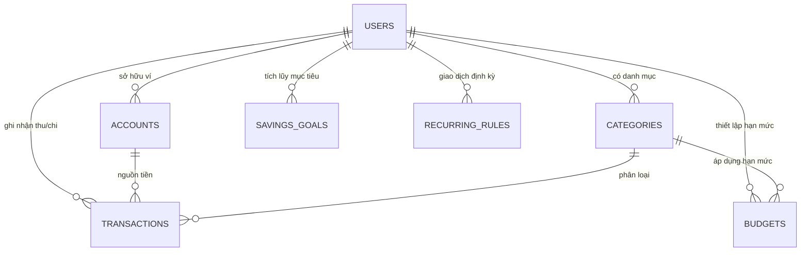

# KẾ HOẠCH THIẾT KẾ & TRIỂN KHAI ỨNG DỤNG QUẢN LÝ CHI TIÊU CÁ NHÂN (MULTI-USER INDIVIDUAL)

> **Mục tiêu:** Xây dựng ứng dụng quản lý tài chính, thu chi cá nhân dành cho bạn và một số cá nhân khác cùng sử dụng trên hệ thống (mỗi người quản lý sổ thu chi, ví, ngân sách và mục tiêu cá nhân độc lập, không có phần chia bill nhóm phức tạp) — tối ưu cho nhập liệu nhanh trên điện thoại, trực quan trên Web, chi phí vận hành tối thiểu.

---

## 1. Tổng Quan Nghiệp Vụ Cốt Lõi

Vì ứng dụng phục vụ **cá nhân bạn và một số cá nhân khác**, hệ thống tập trung vào sự đơn giản, thanh thoát và bảo mật theo từng cá nhân:
1. **Hồ sơ Cá nhân Độc lập (Individual Profiles):** Mỗi người dùng (`user_id`) sở hữu danh sách Ví riêng (Tiền mặt, Tài khoản ngân hàng, Ví điện tử), Danh mục thu chi riêng, Hạn mức ngân sách và Mục tiêu tiết kiệm riêng.
2. **Chuyển đổi / Quản lý Đa Cá Nhân Nhanh Chóng:** Hỗ trợ đăng nhập theo từng tài khoản cá nhân hoặc chuyển đổi nhanh giữa các hồ sơ cá nhân được cấp quyền quản lý trên cùng thiết bị.

---

## 2. Đề Xuất Cấu Trúc Cơ Sở Dữ Liệu Chuẩn OAP (Database Schema — Module `PFM`)

> 📄 **Bộ tài liệu chuẩn OAP trong thư mục `DeSun/Tài Liệu`:**
> - 🌐 **Tài liệu HTML tương tác (SRS, Sơ đồ quy trình, ERD & Bảng biểu):** [`DeSun_SRS_Business_Documentation.html`](./DeSun_SRS_Business_Documentation.html)
> - 📘 **Tài liệu SRS & Quy trình nghiệp vụ (Markdown):** [`SRS_Tai_Lieu_Nghiep_Vu_DeSun.md`](./SRS_Tai_Lieu_Nghiep_Vu_DeSun.md)
> - 🗄️ **Thiết kế CSDL & Script DDL chuẩn OAP:** [`Thiet_Ke_Co_So_Du_Lieu_DeSun.md`](./Thiet_Ke_Co_So_Du_Lieu_DeSun.md)

Thiết kế gồm **8 bảng chuẩn hóa OAP (3NF)** sử dụng tiền tố phân hệ `PFM_` và khóa chính 3 ký tự (`PPR_ID`, `PUD_ID`, `PWA_ID`, `PCA_ID`, `PTR_ID`, `PBU_ID`, `PSG_ID`, `PGD_ID`):
1. **`PFM_PROFILES` (`PPR_ID`)** — Hồ sơ cá nhân sử dụng (`Nguyễn Thanh Đức` và các cá nhân khác).
2. **`PFM_USER_DEVICES` (`PUD_ID`)** — Lưu trạng thái tài khoản đã đăng nhập lần đầu trên thiết bị (`HAS_LOGGED_IN = 'Y'`) để hiển thị trong `<select>` chuyển đổi nhanh.
3. **`PFM_WALLETS` (`PWA_ID`)** — Danh mục Ví & Nguồn tiền cá nhân (`Techcombank Chính`, `Ví MoMo`, `Tiền mặt cá nhân`).
4. **`PFM_CATEGORIES` (`PCA_ID`)** — Danh mục Khoản chi (`EXPENSE`) & Khoản thu (`INCOME`) kèm mã Icon SVG và màu sắc Badge.
5. **`PFM_TRANSACTIONS` (`PTR_ID`)** — Bảng kê Danh sách thu chi cá nhân (`#T1`, `#T2`..., nội dung, danh mục, phân loại, nguồn tiền, ngày, số tiền).
6. **`PFM_BUDGETS` (`PBU_ID`)** — Hạn mức ngân sách chi tiêu tháng theo từng danh mục.
7. **`PFM_SAVINGS_GOALS` (`PSG_ID`)** — Mục tiêu tài chính / Tiết kiệm cá nhân (Header: Tên mục tiêu, Số tiền cần đạt, Số tiền hiện có, Chủ đề màu/Icon).
8. **`PFM_GOAL_DEPOSITS` (`PGD_ID`)** — Lịch sử các lần bấm `+ Nạp tiền` tích lũy vào mục tiêu cá nhân (Detail).

### Sơ đồ Quan hệ Thực thể (ERD)



---

### Phân hệ 1: Người dùng & Nguồn tiền (Users & Wallets)

#### 1. Bảng `users` (Cá nhân sử dụng)
Lưu thông tin tài khoản của bạn và từng cá nhân khác sử dụng hệ thống.
| Cột | Kiểu dữ liệu | Mô tả |
|---|---|---|
| `id` | `UUID` (PK) | Khóa chính người dùng |
| `email` | `VARCHAR(255)` | Email đăng nhập (Unique) |
| `password_hash` | `VARCHAR(255)` | Mật khẩu mã hóa (hoặc dùng Google OAuth) |
| `full_name` | `VARCHAR(100)` | Họ và tên cá nhân (VD: *Nguyễn Thanh Đức*, *Trần Minh Anh*) |
| `avatar_url` | `TEXT` | Ảnh đại diện |
| `role` | `VARCHAR(20)` | `ADMIN` (Quản trị hệ thống) / `USER` (Cá nhân sử dụng) |
| `default_currency` | `VARCHAR(10)` | Tiền tệ mặc định (`VND`) |
| `created_at` | `TIMESTAMPTZ` | Thời gian tạo |

#### 2. Bảng `accounts` (Ví / Nguồn tiền cá nhân)
Quản lý các nguồn tiền của từng cá nhân.
| Cột | Kiểu dữ liệu | Mô tả |
|---|---|---|
| `id` | `UUID` (PK) | Khóa chính ví |
| `user_id` | `UUID` (FK) | Thuộc cá nhân nào (`users.id`) |
| `name` | `VARCHAR(100)` | Tên ví (VD: *Techcombank Chính, Ví MoMo, Tiền mặt cá nhân*) |
| `type` | `VARCHAR(30)` | `CASH`, `BANK`, `E_WALLET`, `CREDIT_CARD`, `SAVING` |
| `account_number` | `VARCHAR(50)` | Số tài khoản / Số thẻ rút gọn (VD: `•••• 8899`) |
| `initial_balance` | `NUMERIC(18,2)` | Số dư ban đầu khi tạo ví |
| `current_balance` | `NUMERIC(18,2)` | Số dư hiện tại (Cập nhật tự động khi thêm/xóa giao dịch) |
| `include_in_total`| `BOOLEAN` | Có cộng vào tổng số dư cá nhân hay không (Default: `true`) |
| `is_archived` | `BOOLEAN` | Ẩn ví không còn sử dụng |

#### 3. Bảng `categories` (Danh mục Thu / Chi)
Danh mục chuẩn hệ thống kết hợp danh mục riêng của từng cá nhân.
| Cột | Kiểu dữ liệu | Mô tả |
|---|---|---|
| `id` | `UUID` (PK) | Khóa chính danh mục |
| `user_id` | `UUID` (FK) | Thuộc cá nhân nào (`NULL` nếu là danh mục mặc định hệ thống) |
| `name` | `VARCHAR(100)` | Tên danh mục (*Ăn uống, Đi lại, Mua sắm, Hóa đơn, Lương chính, Thưởng...*) |
| `type` | `VARCHAR(20)` | `EXPENSE` (Chi tiêu) / `INCOME` (Thu nhập) |
| `icon` / `color` | `VARCHAR(50)` | Mã icon SVG và màu sắc hiển thị |
| `sort_order` | `INT` | Thứ tự ưu tiên hiển thị trên lưới chọn nhanh |

---

### Phân hệ 2: Giao dịch Thu / Chi Cá Nhân (Core Transactions)

#### 4. Bảng `transactions` (Giao dịch Thu / Chi / Chuyển ví)
Bảng trung tâm lưu mọi biến động dòng tiền của từng cá nhân.
| Cột | Kiểu dữ liệu | Mô tả |
|---|---|---|
| `id` | `UUID` (PK) | Khóa chính giao dịch |
| `user_id` | `UUID` (FK) | Thuộc cá nhân nào (`users.id`) |
| `type` | `VARCHAR(20)` | `EXPENSE` (Chi tiêu), `INCOME` (Thu nhập), `TRANSFER` (Chuyển giữa các ví) |
| `account_id` | `UUID` (FK) | Ví nguồn (`accounts.id`) |
| `to_account_id` | `UUID` (FK) | Ví đích (Chỉ dùng khi `type = 'TRANSFER'`) |
| `category_id` | `UUID` (FK) | Danh mục thu/chi (`categories.id`) |
| `amount` | `NUMERIC(18,2)` | Số tiền giao dịch (Luôn `> 0`) |
| `transaction_date`| `DATE` | Ngày phát sinh giao dịch |
| `note` | `TEXT` | Ghi chú giao dịch (VD: *"Siêu thị WinMart"*, *"Ăn trưa"*) |
| `attachment_url` | `TEXT` | Ảnh chụp hóa đơn (Tùy chọn) |
| `created_at` | `TIMESTAMPTZ` | Thời điểm tạo bản ghi |

---

### Phân hệ 3: Ngân sách, Mục tiêu & Định kỳ (Planning & Goals)

#### 5. Bảng `budgets` (Hạn mức ngân sách cá nhân)
Kiểm soát hạn mức chi tiêu tháng theo từng danh mục của mỗi cá nhân.
| Cột | Kiểu dữ liệu | Mô tả |
|---|---|---|
| `id` | `UUID` (PK) | Khóa chính |
| `user_id` | `UUID` (FK) | Thuộc cá nhân nào (`users.id`) |
| `category_id` | `UUID` (FK) | Danh mục áp dụng (`categories.id`) |
| `amount_limit` | `NUMERIC(18,2)` | Hạn mức tối đa trong tháng (VD: `3.000.000 VND` cho Ăn uống) |
| `period_month` | `VARCHAR(7)` | Tháng áp dụng (VD: `2026-10`) |
| `alert_threshold` | `INT` | Ngưỡng cảnh báo (Mặc định `80%`) |

#### 6. Bảng `savings_goals` (Mục tiêu tài chính / Tiết kiệm)
Theo dõi tiến độ tích lũy cho các mục tiêu cá nhân (*Du lịch Đà Lạt, Mua Macbook, Tiết kiệm khẩn cấp*).
| Cột | Kiểu dữ liệu | Mô tả |
|---|---|---|
| `id` | `UUID` (PK) | Khóa chính |
| `user_id` | `UUID` (FK) | Thuộc cá nhân nào (`users.id`) |
| `title` | `VARCHAR(150)` | Tên mục tiêu |
| `target_amount` | `NUMERIC(18,2)` | Số tiền mục tiêu cần đạt |
| `current_amount` | `NUMERIC(18,2)` | Số tiền đã tích lũy hiện tại |
| `deadline` | `DATE` | Ngày dự kiến hoàn thành |
| `icon` / `color` | `VARCHAR(50)` | Biểu tượng & màu sắc |

#### 7. Bảng `recurring_rules` (Giao dịch định kỳ tự động)
Tự động hóa các khoản cố định hàng tháng (Tiền nhà, Điện nước, Internet, Lương).
| Cột | Kiểu dữ liệu | Mô tả |
|---|---|---|
| `id` | `UUID` (PK) | Khóa chính |
| `user_id` | `UUID` (FK) | Thuộc cá nhân nào (`users.id`) |
| `account_id` | `UUID` (FK) | Ví mặc định trừ/cộng tiền |
| `category_id` | `UUID` (FK) | Danh mục |
| `type` | `VARCHAR(20)` | `EXPENSE` / `INCOME` |
| `amount` | `NUMERIC(18,2)` | Số tiền định kỳ |
| `frequency` | `VARCHAR(20)` | `DAILY`, `WEEKLY`, `MONTHLY`, `YEARLY` |
| `next_run_date` | `DATE` | Ngày chạy tiếp theo |
| `is_active` | `BOOLEAN` | Đang hoạt động |

---

## 3. Đề Xuất Công Nghệ (Tech Stack) Tối Ưu Nhất

Vì đây là ứng dụng dùng cho **bản thân và một nhóm nhỏ người quen**, tiêu chí quan trọng nhất là: **Mở lên nhập chi tiêu mất dưới 5 giây trên điện thoại**, **chi phí duy trì 0đ (Free Tier)**, và **phát triển nhanh**.

| Thành phần | Đề xuất 1: Web + PWA (Khuyên dùng nhất) | Đề xuất 2: Mobile App Thuần |
|---|---|---|
| **Giao diện (Frontend)** | **Next.js (React) + TypeScript + TailwindCSS + shadcn/ui** <br>*(Cấu hình PWA để cài trực tiếp icon ra màn hình chính iPhone/Android như App thật)* | **Flutter** hoặc **React Native (Expo)** |
| **Biểu đồ (Charts)** | **Recharts** hoặc **Tremor** | `fl_chart` (Flutter) / `Victory Native` |
| **Backend & Database** | **Supabase** (PostgreSQL + Auth + Storage ảnh bill + Realtime) | **Supabase** hoặc **Firebase** |
| **Nhập liệu siêu tốc** | **Telegram Bot / Zalo Bot** + **Gemini Flash API** *(Nhắn tin: "Ăn trưa 45k ví momo" -> Bot tự bóc tách lưu vào DB)* | Widget màn hình chính |
| **Hosting / Deploy** | **Vercel** (Free) + **Supabase** (Free) = **0đ/tháng** | Cần tài khoản Apple Developer ($99/năm) nếu muốn cài iOS dễ dàng cho nhiều người |

> **Tại sao nên chọn Next.js PWA + Supabase + Telegram Bot?**
> - Không tốn phí $99/năm của Apple Store mà cả người dùng iPhone lẫn Android đều cài được ra màn hình chính.
> - Kết hợp **Telegram Bot**: Đôi khi đi ngoài đường lười mở app, bạn và mọi người chỉ cần nhắn vào bot `cf 35k` hoặc chụp ảnh bill chuyển khoản, hệ thống tự ghi vào sổ ngay lập tức.

---

## 4. Kế Hoạch Triển Khai Chi Tiết (3 Giai Đoạn Tinh Gọn)

### Giai đoạn 1: MVP — Quản lý Thu Chi & Đa Hồ Sơ Cá Nhân (Tuần 1 - Tuần 2)
**Mục tiêu:** Bạn và các cá nhân khác có thể bắt đầu sử dụng hàng ngày để ghi chép thu chi độc lập.
- [ ] **Khởi tạo dự án & Database:** Tạo project trên Supabase, chạy script khởi tạo 7 bảng `users`, `accounts`, `categories`, `transactions`, `budgets`, `savings_goals`, `recurring_rules`.
- [ ] **Authentication & Chuyển đổi Cá nhân:** Đăng nhập nhanh bằng Google hoặc Email/Password; hỗ trợ chuyển đổi nhanh giữa các hồ sơ cá nhân (`Thanh Đức`, `Minh Anh`, `Hoàng Nam`).
- [ ] **Quản lý Ví (`accounts`):** Thêm/sửa/xóa ví cá nhân (Tiền mặt, Ngân hàng, Ví điện tử), tính toán số dư tự động khi thêm/xóa giao dịch.
- [ ] **Popup Thêm giao dịch gọn 1 màn hình (Quick Add):**
  - Tự động phân cách dấu chấm (`.`) hàng nghìn ngay khi nhập số tiền (`450.000`, `1.250.000`).
  - Hỗ trợ 2 tab: **Chi tiêu** | **Thu nhập** cùng lưới chọn danh mục trực quan.
- [ ] **Dashboard & Lịch sử giao dịch:**
  - Thống kê Tổng số dư, Thu nhập tháng, Chi tiêu tháng.
  - Biểu đồ tròn (Donut Chart) tỷ trọng chi tiêu theo danh mục & Biểu đồ cột 6 tháng gần đây.
  - Bộ lọc lịch sử giao dịch theo Chi tiêu, Thu nhập, Từ khóa.

### Giai đoạn 2: Kiểm Soát Ngân Sách & Mục Tiêu Tài Chính (Tuần 3)
**Mục tiêu:** Giúp từng cá nhân kiểm soát hạn mức chi tiêu chủ động và theo dõi tiết kiệm.
- [ ] **Ngân sách chi tiêu (`budgets`):**
  - Đặt hạn mức tháng cho từng danh mục (VD: *Ăn uống tối đa 3.000.000 ₫/tháng*).
  - Thanh tiến trình (Progress bar) trực quan theo phần trăm đã dùng.
- [ ] **Mục tiêu tiết kiệm (`savings_goals`):** Theo dõi tiến độ tích lũy cho các mục tiêu cá nhân (*Du lịch Đà Lạt, Mua Macbook, Tiết kiệm khẩn cấp*).
- [ ] **Giao dịch định kỳ (`recurring_rules`):** Tự động ghi nhận hoặc nhắc lịch cho tiền nhà, điện nước, tiền lương hàng tháng.

### Giai đoạn 3: Tiện Ích Thông Minh & Trải Nghiệm Cao Cấp (Tuần 4)
**Mục tiêu:** Tối ưu tốc độ sử dụng trên cả Web máy tính và Điện thoại.
- [ ] **Tối ưu Responsive & PWA (Progressive Web App):** Tự động thích ứng giao diện Sidebar trên Web máy tính và Bottom Navigation trên Điện thoại; cài đặt icon app ra màn hình chính iOS/Android.
- [ ] **Tích hợp AI / Bot nhập liệu nhanh (Tùy chọn):**
  - Kết nối Telegram Bot: Nhắn văn bản tự nhiên (`"Đổ xăng 70k tiền mặt"`) -> tự bóc tách và lưu thẳng vào sổ cá nhân.
- [ ] **Xuất/Nhập dữ liệu:** Hỗ trợ Export ra Excel/CSV theo từng cá nhân.

---

## 5. Cấu Trúc Thư Mục Dự Án Đề Xuất (Nếu tự code với Next.js)

```text
desun-expense-app/
├── prisma/ (hoặc supabase/migrations/)
│   └── 001_init_schema.sql                   # Định nghĩa 7 bảng Database cá nhân
├── public/
│   ├── desun-logo.svg                        # Logo chính thức DeSun
│   └── manifest.json                         # Cấu hình cài đặt PWA trên điện thoại
├── src/
│   ├── app/
│   │   ├── (auth)/login/                     # Trang đăng nhập cá nhân
│   │   ├── (dashboard)/
│   │   │   ├── page.tsx                      # Trang chủ Tổng quan tài sản & biểu đồ
│   │   │   ├── transactions/                 # Lịch sử & bộ lọc giao dịch
│   │   │   ├── budgets/                      # Hạn mức ngân sách & Mục tiêu tiết kiệm
│   │   │   └── profile/                      # Hồ sơ cá nhân, Nguồn tiền & Chuyển đổi user
│   │   └── api/
│   │       └── transactions/                 # API xử lý giao dịch & cập nhật số dư
│   ├── components/
│   │   ├── add-transaction-modal.tsx         # Popup thêm giao dịch gọn 1 màn hình (tự phân cách dấu chấm)
│   │   ├── user-switcher.tsx                 # Chuyển đổi nhanh giữa các cá nhân sử dụng
│   │   └── charts/                           # Biểu đồ Donut & Biểu đồ 6 tháng
│   └── lib/
│       ├── db.ts                             # Kết nối Database
│       └── currency.ts                       # Format tiền tệ VNĐ có dấu chấm phân cách
└── package.json
```
