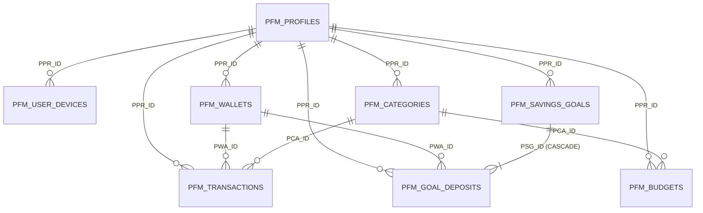

# THIẾT KẾ CƠ SỞ DỮ LIỆU CHUẨN OAP — HỆ THỐNG QUẢN LÝ CHI TIÊU CÁ NHÂN DESUN (PFM)

> **Mã phân hệ (Module Code):** `PFM` (*Personal Finance Management — DeSun*)  
> **Phiên bản:** 3.0 — Chuẩn quy ước đặt tên bảng, khóa chính 3 ký tự (`PPR_ID`, `PWA_ID`, `PCA_ID`, `PTR_ID`...), Sequence, Trigger tự động và cột Audit chuẩn nền tảng **OAP**.  
> **Nguyên tắc tuân thủ:** Không sử dụng tiền tố schema trong câu lệnh SQL/PLSQL; tự động đồng bộ số dư Ví (`PFM_WALLETS`) và tiến độ Mục tiêu (`PFM_SAVINGS_GOALS`) ngay khi phát sinh giao dịch.

---

## 1. Quy Ước Đặt Tên Chuẩn OAP (Naming Conventions)

| Thành phần | Quy chuẩn OAP áp dụng | Ví dụ trong phân hệ DeSun (`PFM`) |
|---|---|---|
| **Tên bảng (Table Name)** | `PFM_<TÊN_THỰC_THỂ_SỐ_NHIỀU>` | `PFM_PROFILES`, `PFM_WALLETS`, `PFM_TRANSACTIONS` |
| **Khóa chính (Primary Key)** | `<3_KÝ_TỰ_VIẾT_TẮT>_ID NUMBER` | `PPR_ID`, `PUD_ID`, `PWA_ID`, `PCA_ID`, `PTR_ID`, `PBU_ID`, `PSG_ID`, `PGD_ID` |
| **Sequence tự tăng** | `<TÊN_BẢNG>_SEQ` | `PFM_TRANSACTIONS_SEQ`, `PFM_SAVINGS_GOALS_SEQ` |
| **Ràng buộc Unique (UK)** | `<TÊN_BẢNG>_UK_<CỘT>` | `PFM_PROFILES_UK_EMAIL`, `PFM_BUDGETS_UK_PERIOD` |
| **Chỉ mục (Index)** | `IDX_<3_KÝ_TỰ>_<TÊN_CỘT>` | `IDX_PTR_PPR_DATE`, `IDX_PTR_PCA_TYPE` |
| **Trigger tự động** | `TRG_<3_KÝ_TỰ>_<HÀNH_ĐỘNG>` | `TRG_PTR_SYNC_WALLET_BAL`, `TRG_PGD_SYNC_GOAL_AMT` |
| **Cột Trạng thái & Audit** | Chuẩn OAP | `STATUS ('Y'/'N'/'D')`, `CREATED_DATE`, `CREATED_BY`, `MODIFY_DATE`, `MODIFIED_BY` |

---

## 2. Danh Mục Tổng Quan 8 Bảng Chuẩn OAP

| STT | Tên Bảng Chuẩn OAP | Khóa Chính (PK) | Khóa Ngoại (FK) | Nhóm Nghiệp Vụ | Màn Hình / Chức Năng Giao Diện Tương Ứng |
|---|---|---|---|---|---|
| 1 | **`PFM_PROFILES`** | `PPR_ID` | — | **Master / Auth** | Trang Đăng Nhập, Hồ sơ cá nhân sử dụng (`Nguyễn Thanh Đức`, `Trần Minh Anh`...) |
| 2 | **`PFM_USER_DEVICES`** | `PUD_ID` | `PPR_ID` | **Auth / Session** | Ô chọn `<select>` **Cá nhân sử dụng** *(Chỉ hiển thị user có `HAS_LOGGED_IN = 'Y'` trên thiết bị)* |
| 3 | **`PFM_WALLETS`** | `PWA_ID` | `PPR_ID` | **Master / Source** | Trang **Cá nhân & Nguồn tiền**, ô chọn `<select>` Nguồn tiền (`Techcombank Chính`, `Ví MoMo`, `Tiền mặt`) |
| 4 | **`PFM_CATEGORIES`** | `PCA_ID` | `PPR_ID` | **Config / LOV** | Lưới chọn Danh mục trên **Popup Thêm giao dịch**, bộ lọc `<select>` Danh mục, Biểu đồ tròn |
| 5 | **`PFM_TRANSACTIONS`** | `PTR_ID` | `PPR_ID`, `PWA_ID`, `PCA_ID` | **Core Transaction** | Bảng **Danh sách thu chi**, Popup **Thêm giao dịch**, KPI Tổng thu/chi, Biểu đồ 6 tháng |
| 6 | **`PFM_BUDGETS`** | `PBU_ID` | `PPR_ID`, `PCA_ID` | **Planning** | Tab **Ngân sách** & Popup **Sửa hạn mức chi tiêu tháng** |
| 7 | **`PFM_SAVINGS_GOALS`** | `PSG_ID` | `PPR_ID` | **Goal Header** | Tab **Mục tiêu tiết kiệm**, Khung **Mục tiêu tài chính**, Popup **Thêm/Sửa mục tiêu cá nhân** |
| 8 | **`PFM_GOAL_DEPOSITS`** | `PGD_ID` | `PSG_ID`, `PPR_ID`, `PWA_ID` | **Goal Detail** | Popup **Nạp tích lũy mục tiêu (`+ Nạp tiền`)** & Lịch sử tích lũy |

---

## 3. Sơ Đồ Quan Hệ Thực Thể (ERD Chuẩn OAP)



---

## 4. Đặc Tả Chi Tiết Từng Bảng (Data Dictionary)

### 4.1. Bảng `PFM_PROFILES` — Hồ Sơ Cá Nhân Sử Dụng
Lưu thông tin định danh của cá nhân bạn (`Nguyễn Thanh Đức`) và các cá nhân khác sử dụng độc lập trên hệ thống.

| STT | Tên Cột | Kiểu Dữ Liệu | Ràng Buộc | Mô Tả Nghiệp Vụ |
|---|---|---|---|---|
| 1 | `PPR_ID` | `NUMBER` | `PRIMARY KEY` | Khóa chính tự tăng qua `PFM_PROFILES_SEQ` |
| 2 | `PROFILE_CODE` | `VARCHAR2(50)` | `NOT NULL, UNIQUE` | Mã hồ sơ cá nhân (VD: `USR_DUC`, `USR_MINHANH`) |
| 3 | `EMAIL` | `VARCHAR2(150)` | `NOT NULL, UNIQUE` | Email đăng nhập (VD: `duc.nguyen@desun.vn`) |
| 4 | `PASSWORD_HASH` | `VARCHAR2(255)` | `NOT NULL` | Mật khẩu bảo mật |
| 5 | `FULL_NAME` | `VARCHAR2(200)` | `NOT NULL` | Họ và tên đầy đủ (VD: `Nguyễn Thanh Đức`) |
| 6 | `DISPLAY_NAME` | `VARCHAR2(100)` | `NOT NULL` | Tên rút gọn hiển thị trên Header/Sidebar (VD: `Thanh Đức`) |
| 7 | `AVATAR_INITIALS` | `VARCHAR2(10)` | `NOT NULL` | Chữ viết tắt hiển thị trong vòng tròn Avatar (`TĐ`, `MA`, `HN`) |
| 8 | `ROLE_TYPE` | `VARCHAR2(30)` | `DEFAULT 'INDIVIDUAL'` | Loại hồ sơ (`OWNER`: Cá nhân tôi, `INDIVIDUAL`: Cá nhân khác) |
| 9 | `CURRENCY_CODE` | `VARCHAR2(10)` | `DEFAULT 'VND'` | Đơn vị tiền tệ mặc định (`VND`) |
| 10 | `BALANCE_HIDDEN` | `VARCHAR2(1)` | `DEFAULT 'N'` | Ẩn/Hiện số dư trên thẻ Tổng số dư (`Y` / `N`) |
| 11 | `LAST_LOGIN_DATE` | `DATE` | `NULL` | Thời điểm đăng nhập gần nhất |
| 12 | `STATUS` | `VARCHAR2(1)` | `DEFAULT 'Y'` | Trạng thái bản ghi (`Y`: Hoạt động, `N`: Ngưng, `D`: Đã xóa) |
| 13 | `CREATED_DATE` | `DATE` | `DEFAULT SYSDATE` | Ngày tạo bản ghi |
| 14 | `CREATED_BY` | `VARCHAR2(50)` | `NULL` | Người tạo (`COALESCE(:p_username, USER)`) |
| 15 | `MODIFY_DATE` | `DATE` | `NULL` | Ngày cập nhật gần nhất |
| 16 | `MODIFIED_BY` | `VARCHAR2(50)` | `NULL` | Người cập nhật gần nhất |

---

### 4.2. Bảng `PFM_USER_DEVICES` — Thiết Bị & Tài Khoản Đã Đăng Nhập Lần Đầu
Phục vụ đúng nghiệp vụ trên giao diện: **Chỉ những tài khoản đã đăng nhập ít nhất 1 lần (`HAS_LOGGED_IN = 'Y'`) trên thiết bị mới xuất hiện trong ô `<select>` chuyển đổi nhanh**.

| STT | Tên Cột | Kiểu Dữ Liệu | Ràng Buộc | Mô Tả Nghiệp Vụ |
|---|---|---|---|---|
| 1 | `PUD_ID` | `NUMBER` | `PRIMARY KEY` | Khóa chính tự tăng qua `PFM_USER_DEVICES_SEQ` |
| 2 | `DEVICE_TOKEN` | `VARCHAR2(150)` | `NOT NULL` | Mã định danh trình duyệt / thiết bị |
| 3 | `PPR_ID` | `NUMBER` | `NOT NULL, FK` | Tham chiếu `PFM_PROFILES(PPR_ID)` |
| 4 | `HAS_LOGGED_IN` | `VARCHAR2(1)` | `DEFAULT 'Y'` | `Y`: Đã đăng nhập lần đầu thành công trên thiết bị -> Hiện trong `<select>` |
| 5 | `REMEMBER_ME` | `VARCHAR2(1)` | `DEFAULT 'Y'` | Duy trì đăng nhập nhanh (`Y` / `N`) |
| 6 | `FIRST_LOGIN_DATE`| `DATE` | `DEFAULT SYSDATE` | Ngày giờ đăng nhập lần đầu tiên trên thiết bị |
| 7 | `LAST_ACTIVE_DATE`| `DATE` | `DEFAULT SYSDATE` | Ngày giờ chuyển đổi / sử dụng gần nhất |
| 8 | `STATUS` | `VARCHAR2(1)` | `DEFAULT 'Y'` | Trạng thái (`Y`: Đang lưu trên thiết bị, `N`: Đã gỡ khỏi thiết bị) |
| 9 | `CREATED_DATE` | `DATE` | `DEFAULT SYSDATE` | Ngày tạo |
| 10 | `CREATED_BY` | `VARCHAR2(50)` | `NULL` | Người tạo |
| 11 | `MODIFY_DATE` | `DATE` | `NULL` | Ngày sửa |
| 12 | `MODIFIED_BY` | `VARCHAR2(50)` | `NULL` | Người sửa |

---

### 4.3. Bảng `PFM_WALLETS` — Danh Mục Ví & Nguồn Tiền Cá Nhân
Quản lý các nguồn tiền của từng cá nhân (`Techcombank Chính`, `Ví MoMo`, `Tiền mặt cá nhân`).

| STT | Tên Cột | Kiểu Dữ Liệu | Ràng Buộc | Mô Tả Nghiệp Vụ |
|---|---|---|---|---|
| 1 | `PWA_ID` | `NUMBER` | `PRIMARY KEY` | Khóa chính tự tăng qua `PFM_WALLETS_SEQ` |
| 2 | `PPR_ID` | `NUMBER` | `NOT NULL, FK` | Thuộc cá nhân nào (`PFM_PROFILES.PPR_ID`) |
| 3 | `WALLET_CODE` | `VARCHAR2(50)` | `NOT NULL` | Mã nguồn tiền (VD: `W_TCB`, `W_MOMO`, `W_CASH`) |
| 4 | `WALLET_NAME` | `VARCHAR2(200)` | `NOT NULL` | Tên hiển thị (VD: `Techcombank Chính`, `Ví MoMo`, `Tiền mặt cá nhân`) |
| 5 | `WALLET_TYPE` | `VARCHAR2(30)` | `NOT NULL` | Phân loại: `BANK` (Ngân hàng), `E_WALLET` (Ví điện tử), `CASH` (Tiền mặt) |
| 6 | `ACCOUNT_NO_MASK` | `VARCHAR2(50)` | `NULL` | Số tài khoản / mô tả rút gọn (`•••• 8899`, `0909 ••• 123`, `VND`) |
| 7 | `INITIAL_BALANCE` | `NUMBER(18,2)` | `DEFAULT 0` | Số dư ban đầu khi khởi tạo ví |
| 8 | `CURRENT_BALANCE` | `NUMBER(18,2)` | `DEFAULT 0` | Số dư thực tế hiện tại (Tự động cập nhật qua Trigger khi thêm/xóa giao dịch) |
| 9 | `IS_DEFAULT` | `VARCHAR2(1)` | `DEFAULT 'N'` | Ví mặc định được chọn sẵn khi mở Popup Thêm giao dịch (`Y` / `N`) |
| 10 | `SORT_ORDER` | `NUMBER(5)` | `DEFAULT 1` | Thứ tự ưu tiên hiển thị |
| 11 | `STATUS` | `VARCHAR2(1)` | `DEFAULT 'Y'` | Trạng thái (`Y` / `N` / `D`) |
| 12 | `CREATED_DATE` | `DATE` | `DEFAULT SYSDATE` | Ngày tạo |
| 13 | `CREATED_BY` | `VARCHAR2(50)` | `NULL` | Người tạo |
| 14 | `MODIFY_DATE` | `DATE` | `NULL` | Ngày sửa |
| 15 | `MODIFIED_BY` | `VARCHAR2(50)` | `NULL` | Người sửa |

---

### 4.4. Bảng `PFM_CATEGORIES` — Danh Mục Khoản Chi & Khoản Thu
Lưu các danh mục chuẩn (`Ăn uống`, `Đi lại`, `Mua sắm`, `Hóa đơn`, `Giải trí`, `Sức khỏe`, `Học tập`, `Lương chính`, `Thưởng`, `Đầu tư`...) kèm màu sắc pill badge và icon SVG.

| STT | Tên Cột | Kiểu Dữ Liệu | Ràng Buộc | Mô Tả Nghiệp Vụ |
|---|---|---|---|---|
| 1 | `PCA_ID` | `NUMBER` | `PRIMARY KEY` | Khóa chính tự tăng qua `PFM_CATEGORIES_SEQ` |
| 2 | `PPR_ID` | `NUMBER` | `NULL, FK` | `NULL` nếu là danh mục dùng chung, hoặc `PPR_ID` nếu cá nhân tạo riêng |
| 3 | `CATEGORY_CODE` | `VARCHAR2(50)` | `NOT NULL, UNIQUE` | Mã danh mục (`CAT_FOOD`, `CAT_MOVE`, `CAT_SALARY`...) |
| 4 | `CATEGORY_NAME` | `VARCHAR2(200)` | `NOT NULL` | Tên danh mục (`Ăn uống`, `Đi lại`, `Lương chính`...) |
| 5 | `TX_TYPE` | `VARCHAR2(20)` | `NOT NULL` | `EXPENSE` (Khoản chi) hoặc `INCOME` (Khoản thu) |
| 6 | `ICON_CODE` | `VARCHAR2(50)` | `NOT NULL` | Mã biểu tượng SVG (`utensils`, `car`, `bag`, `receipt`, `wallet`...) |
| 7 | `COLOR_HEX` | `VARCHAR2(20)` | `NOT NULL` | Mã màu chữ/viền Badge & Biểu đồ (`#F59E0B`, `#10B981`, `#F97316`...) |
| 8 | `BG_COLOR_HEX` | `VARCHAR2(20)` | `NOT NULL` | Mã màu nền Badge (`#FEF3C7`, `#DCFCE7`, `#FFEDD5`...) |
| 9 | `DEFAULT_LIMIT` | `NUMBER(18,2)` | `DEFAULT 0` | Hạn mức chi tiêu tháng mặc định (áp dụng cho `EXPENSE`) |
| 10 | `SORT_ORDER` | `NUMBER(5)` | `DEFAULT 1` | Thứ tự hiển thị trên lưới 4 cột trong Popup |
| 11 | `STATUS` | `VARCHAR2(1)` | `DEFAULT 'Y'` | Trạng thái (`Y` / `N` / `D`) |
| 12 | `CREATED_DATE` | `DATE` | `DEFAULT SYSDATE` | Ngày tạo |
| 13 | `CREATED_BY` | `VARCHAR2(50)` | `NULL` | Người tạo |
| 14 | `MODIFY_DATE` | `DATE` | `NULL` | Ngày sửa |
| 15 | `MODIFIED_BY` | `VARCHAR2(50)` | `NULL` | Người sửa |

---

### 4.5. Bảng `PFM_TRANSACTIONS` — Bảng Kê Danh Sách Thu Chi Cá Nhân
Bảng nghiệp vụ trung tâm lưu toàn bộ các khoản thu chi cá nhân hiển thị trên bảng **Danh sách thu chi**, thẻ KPI và biểu đồ.

| STT | Tên Cột | Kiểu Dữ Liệu | Ràng Buộc | Mô Tả Nghiệp Vụ |
|---|---|---|---|---|
| 1 | `PTR_ID` | `NUMBER` | `PRIMARY KEY` | Khóa chính tự tăng qua `PFM_TRANSACTIONS_SEQ` |
| 2 | `TX_CODE` | `VARCHAR2(50)` | `NOT NULL` | Mã giao dịch tự sinh hiển thị trên bảng (VD: `T1`, `T2`, `GD-202610-0001`) |
| 3 | `PPR_ID` | `NUMBER` | `NOT NULL, FK` | Cá nhân thực hiện (`PFM_PROFILES.PPR_ID`) |
| 4 | `PWA_ID` | `NUMBER` | `NOT NULL, FK` | Nguồn tiền / Ví thanh toán (`PFM_WALLETS.PWA_ID`) |
| 5 | `PCA_ID` | `NUMBER` | `NOT NULL, FK` | Danh mục thu chi (`PFM_CATEGORIES.PCA_ID`) |
| 6 | `TX_TYPE` | `VARCHAR2(20)` | `NOT NULL` | `EXPENSE` (▼ Khoản chi) hoặc `INCOME` (▲ Khoản thu) |
| 7 | `AMOUNT` | `NUMBER(18,2)` | `NOT NULL, CHECK (>0)` | Số tiền giao dịch (VNĐ) — nhập trên UI có dấu chấm `.` phân cách hàng nghìn |
| 8 | `TITLE` | `VARCHAR2(300)` | `NOT NULL` | Khoản mục / Nội dung hiển thị chính trên bảng (VD: `Siêu thị WinMart`) |
| 9 | `NOTE` | `VARCHAR2(1000)` | `NULL` | Ghi chú bổ sung |
| 10 | `TX_DATE` | `DATE` | `DEFAULT SYSDATE` | Ngày phát sinh giao dịch |
| 11 | `PERIOD_MONTH` | `VARCHAR2(7)` | `NOT NULL` | Kỳ hạch toán `YYYY-MM` (VD: `2026-10`) để tổng hợp nhanh biểu đồ 6 tháng |
| 12 | `STATUS` | `VARCHAR2(1)` | `DEFAULT 'Y'` | Trạng thái (`Y`: Hợp lệ, `D`: Đã xóa) |
| 13 | `CREATED_DATE` | `DATE` | `DEFAULT SYSDATE` | Ngày tạo |
| 14 | `CREATED_BY` | `VARCHAR2(50)` | `NULL` | Người tạo |
| 15 | `MODIFY_DATE` | `DATE` | `NULL` | Ngày sửa |
| 16 | `MODIFIED_BY` | `VARCHAR2(50)` | `NULL` | Người sửa |

---

### 4.6. Bảng `PFM_BUDGETS` — Hạn Mức Ngân Sách Chi Tiêu Theo Tháng
Phục vụ màn hình **Ngân sách** và chức năng **Sửa hạn mức** cho từng danh mục chi tiêu.

| STT | Tên Cột | Kiểu Dữ Liệu | Ràng Buộc | Mô Tả Nghiệp Vụ |
|---|---|---|---|---|
| 1 | `PBU_ID` | `NUMBER` | `PRIMARY KEY` | Khóa chính tự tăng qua `PFM_BUDGETS_SEQ` |
| 2 | `PPR_ID` | `NUMBER` | `NOT NULL, FK` | Thuộc cá nhân nào (`PFM_PROFILES.PPR_ID`) |
| 3 | `PCA_ID` | `NUMBER` | `NOT NULL, FK` | Danh mục chi tiêu áp dụng (`PFM_CATEGORIES.PCA_ID`) |
| 4 | `PERIOD_MONTH` | `VARCHAR2(7)` | `NOT NULL` | Tháng áp dụng định dạng `YYYY-MM` (VD: `2026-10`) |
| 5 | `LIMIT_AMOUNT` | `NUMBER(18,2)` | `NOT NULL, CHECK (>0)` | Hạn mức ngân sách tối đa trong tháng (VD: `3000000`) |
| 6 | `SPENT_AMOUNT` | `NUMBER(18,2)` | `DEFAULT 0` | Số tiền đã chi trong tháng (Cập nhật tự động hoặc tính qua View) |
| 7 | `ALERT_THRESHOLD` | `NUMBER(5,2)` | `DEFAULT 80` | Ngưỡng cảnh báo phần trăm (Mặc định `80%`) |
| 8 | `STATUS` | `VARCHAR2(1)` | `DEFAULT 'Y'` | Trạng thái (`Y` / `N` / `D`) |
| 9 | `CREATED_DATE` | `DATE` | `DEFAULT SYSDATE` | Ngày tạo |
| 10 | `CREATED_BY` | `VARCHAR2(50)` | `NULL` | Người tạo |
| 11 | `MODIFY_DATE` | `DATE` | `NULL` | Ngày sửa |
| 12 | `MODIFIED_BY` | `VARCHAR2(50)` | `NULL` | Người sửa |

---

### 4.7. Bảng `PFM_SAVINGS_GOALS` — Mục Tiêu Tài Chính / Tiết Kiệm Cá Nhân (Header)
Phục vụ màn hình **Mục tiêu tiết kiệm**, khung **Mục tiêu tài chính cá nhân** trên Trang chủ, và **Popup Thêm / Chỉnh sửa mục tiêu cá nhân**.

| STT | Tên Cột | Kiểu Dữ Liệu | Ràng Buộc | Mô Tả Nghiệp Vụ |
|---|---|---|---|---|
| 1 | `PSG_ID` | `NUMBER` | `PRIMARY KEY` | Khóa chính tự tăng qua `PFM_SAVINGS_GOALS_SEQ` |
| 2 | `PPR_ID` | `NUMBER` | `NOT NULL, FK` | Thuộc cá nhân nào (`PFM_PROFILES.PPR_ID`) |
| 3 | `GOAL_CODE` | `VARCHAR2(50)` | `NOT NULL` | Mã mục tiêu (`GOAL_01`, `GOAL_02`...) |
| 4 | `TITLE` | `VARCHAR2(200)` | `NOT NULL` | Tên mục tiêu cá nhân (`Quỹ dự phòng khẩn cấp`, `Du lịch Đà Lạt`, `Mua Macbook Pro`) |
| 5 | `TARGET_AMOUNT` | `NUMBER(18,2)` | `NOT NULL, CHECK (>0)` | Số tiền mục tiêu cần đạt (VNĐ) |
| 6 | `CURRENT_AMOUNT` | `NUMBER(18,2)` | `DEFAULT 0` | Số tiền đã tích lũy hiện tại (VNĐ) |
| 7 | `THEME_ID` | `VARCHAR2(30)` | `DEFAULT 'emerald'` | Chủ đề màu chọn trên Popup (`emerald`, `sky`, `violet`, `orange`, `pink`) |
| 8 | `ICON_CODE` | `VARCHAR2(50)` | `DEFAULT 'shieldCheck'`| Biểu tượng SVG (`shieldCheck`, `plane`, `laptop`, `bag`, `heart`) |
| 9 | `COLOR_HEX` | `VARCHAR2(20)` | `NOT NULL` | Mã màu thanh tiến trình (`#10B981`, `#0284C7`, `#8B5CF6`, `#F97316`, `#EC4899`) |
| 10 | `BG_COLOR_HEX` | `VARCHAR2(20)` | `NOT NULL` | Mã màu nền icon (`#DCFCE7`, `#E0F2FE`, `#EDE9FE`, `#FFEDD5`, `#FCE7F3`) |
| 11 | `GOAL_STATUS` | `VARCHAR2(20)` | `DEFAULT 'ACTIVE'` | `ACTIVE` (Đang tích lũy), `COMPLETED` (Hoàn thành 100%) |
| 12 | `STATUS` | `VARCHAR2(1)` | `DEFAULT 'Y'` | Trạng thái bản ghi (`Y` / `N` / `D`) |
| 13 | `CREATED_DATE` | `DATE` | `DEFAULT SYSDATE` | Ngày tạo |
| 14 | `CREATED_BY` | `VARCHAR2(50)` | `NULL` | Người tạo |
| 15 | `MODIFY_DATE` | `DATE` | `NULL` | Ngày sửa |
| 16 | `MODIFIED_BY` | `VARCHAR2(50)` | `NULL` | Người sửa |

---

### 4.8. Bảng `PFM_GOAL_DEPOSITS` — Lịch Sử Nạp Tiền Tích Lũy Mục Tiêu (Detail)
Lưu từng lần cá nhân bấm nút **`+ Nạp tiền`** trên mục tiêu và xác nhận số tiền nạp trong Popup.

| STT | Tên Cột | Kiểu Dữ Liệu | Ràng Buộc | Mô Tả Nghiệp Vụ |
|---|---|---|---|---|
| 1 | `PGD_ID` | `NUMBER` | `PRIMARY KEY` | Khóa chính tự tăng qua `PFM_GOAL_DEPOSITS_SEQ` |
| 2 | `PSG_ID` | `NUMBER` | `NOT NULL, FK` | Tham chiếu `PFM_SAVINGS_GOALS(PSG_ID) ON DELETE CASCADE` |
| 3 | `PPR_ID` | `NUMBER` | `NOT NULL, FK` | Cá nhân thực hiện nạp (`PFM_PROFILES.PPR_ID`) |
| 4 | `PWA_ID` | `NUMBER` | `NULL, FK` | Nguồn tiền trích nạp (`PFM_WALLETS.PWA_ID`) |
| 5 | `DEPOSIT_AMOUNT` | `NUMBER(18,2)` | `NOT NULL, CHECK (>0)` | Số tiền nạp thêm (VD: `1.000.000`) |
| 6 | `DEPOSIT_DATE` | `DATE` | `DEFAULT SYSDATE` | Ngày giờ nạp tích lũy |
| 7 | `NOTE` | `VARCHAR2(500)` | `NULL` | Ghi chú lần nạp |
| 8 | `STATUS` | `VARCHAR2(1)` | `DEFAULT 'Y'` | Trạng thái (`Y` / `N` / `D`) |
| 9 | `CREATED_DATE` | `DATE` | `DEFAULT SYSDATE` | Ngày tạo |
| 10 | `CREATED_BY` | `VARCHAR2(50)` | `NULL` | Người tạo |
| 11 | `MODIFY_DATE` | `DATE` | `NULL` | Ngày sửa |
| 12 | `MODIFIED_BY` | `VARCHAR2(50)` | `NULL` | Người sửa |

---

## 5. Script DDL Chuẩn OAP (Sequences, Tables, Inline Comments & COMMENT ON COLUMN)

```sql
-- ============================================================================
-- 1. SEQUENCES CHUẨN OAP (TỰ TĂNG KHÓA CHÍNH 3 KÝ TỰ)
-- ============================================================================
CREATE SEQUENCE PFM_PROFILES_SEQ      START WITH 1 INCREMENT BY 1 NOCACHE NOCYCLE;
CREATE SEQUENCE PFM_USER_DEVICES_SEQ  START WITH 1 INCREMENT BY 1 NOCACHE NOCYCLE;
CREATE SEQUENCE PFM_WALLETS_SEQ       START WITH 1 INCREMENT BY 1 NOCACHE NOCYCLE;
CREATE SEQUENCE PFM_CATEGORIES_SEQ    START WITH 1 INCREMENT BY 1 NOCACHE NOCYCLE;
CREATE SEQUENCE PFM_TRANSACTIONS_SEQ  START WITH 1 INCREMENT BY 1 NOCACHE NOCYCLE;
CREATE SEQUENCE PFM_BUDGETS_SEQ       START WITH 1 INCREMENT BY 1 NOCACHE NOCYCLE;
CREATE SEQUENCE PFM_SAVINGS_GOALS_SEQ START WITH 1 INCREMENT BY 1 NOCACHE NOCYCLE;
CREATE SEQUENCE PFM_GOAL_DEPOSITS_SEQ START WITH 1 INCREMENT BY 1 NOCACHE NOCYCLE;

-- ============================================================================
-- 2.1. BẢNG PFM_PROFILES (Hồ sơ Cá nhân sử dụng)
-- ============================================================================
CREATE TABLE PFM_PROFILES (
  PPR_ID          NUMBER        PRIMARY KEY,                                     -- [PK] Khóa chính tự tăng (PFM_PROFILES_SEQ)
  PROFILE_CODE    VARCHAR2(50)  NOT NULL,                                        -- [UK] Mã định danh hồ sơ cá nhân (VD: USR_DUC, USR_MINHANH)
  EMAIL           VARCHAR2(150) NOT NULL,                                        -- [UK] Địa chỉ Email đăng nhập duy nhất
  PASSWORD_HASH   VARCHAR2(255) NOT NULL,                                        -- Mật khẩu đăng nhập đã mã hóa bảo mật
  FULL_NAME       VARCHAR2(200) NOT NULL,                                        -- Họ và tên đầy đủ của cá nhân (VD: Nguyễn Thanh Đức)
  DISPLAY_NAME    VARCHAR2(100) NOT NULL,                                        -- Tên rút gọn hiển thị trên Header/Sidebar (VD: Thanh Đức)
  AVATAR_INITIALS VARCHAR2(10)  NOT NULL,                                        -- Chữ viết tắt hiển thị trong vòng tròn Avatar (Đ, A, N)
  AVATAR_COLOR    VARCHAR2(100) DEFAULT '#ea580c',                               -- Mã màu nền Avatar của cá nhân
  ROLE_TYPE       VARCHAR2(30)  DEFAULT 'INDIVIDUAL',                            -- Phân loại: OWNER (Chủ tài khoản chính), INDIVIDUAL (Cá nhân khác)
  CURRENCY_CODE   VARCHAR2(10)  DEFAULT 'VND' NOT NULL,                          -- Đơn vị tiền tệ mặc định ('VND')
  BALANCE_HIDDEN  VARCHAR2(1)   DEFAULT 'N' CHECK (BALANCE_HIDDEN IN ('Y','N')), -- Trạng thái ẩn số dư tài sản ('Y': Ẩn ****, 'N': Hiển thị)
  LAST_LOGIN_DATE DATE,                                                          -- Thời điểm đăng nhập thành công gần nhất
  STATUS          VARCHAR2(1)   DEFAULT 'Y' CHECK (STATUS IN ('Y', 'N', 'D')),   -- Trạng thái bản ghi chuẩn OAP ('Y': Active, 'N': Inactive, 'D': Deleted)
  CREATED_DATE    DATE          DEFAULT SYSDATE,                                 -- [Audit OAP] Ngày giờ tạo bản ghi
  CREATED_BY      VARCHAR2(50),                                                  -- [Audit OAP] Người tạo bản ghi (COALESCE(:p_username, USER))
  MODIFY_DATE     DATE,                                                          -- [Audit OAP] Ngày giờ cập nhật gần nhất
  MODIFIED_BY     VARCHAR2(50),                                                  -- [Audit OAP] Người cập nhật gần nhất
  CONSTRAINT PFM_PROFILES_UK_CODE  UNIQUE (PROFILE_CODE),
  CONSTRAINT PFM_PROFILES_UK_EMAIL UNIQUE (EMAIL)
);

COMMENT ON TABLE  PFM_PROFILES                 IS 'Bảng lưu hồ sơ định danh các cá nhân sử dụng hệ thống quản lý chi tiêu DeSun';
COMMENT ON COLUMN PFM_PROFILES.PPR_ID          IS 'Khóa chính định danh hồ sơ cá nhân (Tự tăng qua PFM_PROFILES_SEQ)';
COMMENT ON COLUMN PFM_PROFILES.PROFILE_CODE    IS 'Mã hồ sơ cá nhân duy nhất (VD: USR_DUC, USR_MINHANH, USR_NAM)';
COMMENT ON COLUMN PFM_PROFILES.EMAIL           IS 'Địa chỉ Email dùng để đăng nhập hệ thống';
COMMENT ON COLUMN PFM_PROFILES.PASSWORD_HASH   IS 'Chuỗi mật khẩu đã mã hóa bảo mật';
COMMENT ON COLUMN PFM_PROFILES.FULL_NAME       IS 'Họ và tên đầy đủ của cá nhân sử dụng';
COMMENT ON COLUMN PFM_PROFILES.DISPLAY_NAME    IS 'Tên hiển thị ngắn gọn trên thanh điều hướng';
COMMENT ON COLUMN PFM_PROFILES.AVATAR_INITIALS IS 'Chữ cái viết tắt hiển thị trên Avatar (VD: TĐ, MA, HN)';
COMMENT ON COLUMN PFM_PROFILES.AVATAR_COLOR    IS 'Mã màu HEX hoặc Gradient của Avatar';
COMMENT ON COLUMN PFM_PROFILES.ROLE_TYPE       IS 'Vai trò người dùng: OWNER (Cá nhân bạn) hoặc INDIVIDUAL (Cá nhân độc lập khác)';
COMMENT ON COLUMN PFM_PROFILES.CURRENCY_CODE   IS 'Mã tiền tệ mặc định (Mặc định: VND)';
COMMENT ON COLUMN PFM_PROFILES.BALANCE_HIDDEN  IS 'Cờ ẩn/hiện số dư trên Dashboard (Y: Ẩn số tiền, N: Hiện số tiền)';
COMMENT ON COLUMN PFM_PROFILES.LAST_LOGIN_DATE IS 'Thời điểm người dùng đăng nhập lần cuối';
COMMENT ON COLUMN PFM_PROFILES.STATUS          IS 'Trạng thái chuẩn OAP (Y: Đang hoạt động, N: Ngưng hoạt động, D: Đã xóa)';
COMMENT ON COLUMN PFM_PROFILES.CREATED_DATE    IS 'Ngày giờ khởi tạo bản ghi';
COMMENT ON COLUMN PFM_PROFILES.CREATED_BY      IS 'Tài khoản khởi tạo bản ghi';
COMMENT ON COLUMN PFM_PROFILES.MODIFY_DATE     IS 'Ngày giờ chỉnh sửa bản ghi lần cuối';
COMMENT ON COLUMN PFM_PROFILES.MODIFIED_BY     IS 'Tài khoản chỉnh sửa bản ghi lần cuối';

-- ============================================================================
-- 2.2. BẢNG PFM_USER_DEVICES (Lưu tài khoản đã đăng nhập lần đầu trên thiết bị)
-- ============================================================================
CREATE TABLE PFM_USER_DEVICES (
  PUD_ID           NUMBER        PRIMARY KEY,                                    -- [PK] Khóa chính tự tăng (PFM_USER_DEVICES_SEQ)
  DEVICE_TOKEN     VARCHAR2(150) NOT NULL,                                       -- [UK] Mã định danh trình duyệt/thiết bị của người dùng
  DEVICE_NAME      VARCHAR2(200),                                                -- Tên trình duyệt/thiết bị (VD: Chrome Windows, Safari iPhone)
  PPR_ID           NUMBER        NOT NULL,                                       -- [FK] Tham chiếu cá nhân sử dụng PFM_PROFILES(PPR_ID)
  HAS_LOGGED_IN    VARCHAR2(1)   DEFAULT 'Y' CHECK (HAS_LOGGED_IN IN ('Y','N')), -- Cờ đánh dấu đã đăng nhập lần đầu ('Y' -> Hiện trong ô <select>)
  REMEMBER_ME      VARCHAR2(1)   DEFAULT 'Y' CHECK (REMEMBER_ME IN ('Y','N')),   -- Cho phép chuyển đổi nhanh 1 chạm trong <select> ('Y'/'N')
  FIRST_LOGIN_DATE DATE          DEFAULT SYSDATE,                                -- Thời điểm đăng nhập thành công lần đầu tiên trên thiết bị
  LAST_ACTIVE_DATE DATE          DEFAULT SYSDATE,                                -- Thời điểm chuyển đổi/sử dụng gần nhất trên thiết bị
  STATUS           VARCHAR2(1)   DEFAULT 'Y' CHECK (STATUS IN ('Y', 'N', 'D')),  -- Trạng thái bản ghi chuẩn OAP ('Y': Đang lưu, 'N': Đã gỡ)
  CREATED_DATE     DATE          DEFAULT SYSDATE,                                -- [Audit OAP] Ngày giờ tạo bản ghi
  CREATED_BY       VARCHAR2(50),                                                 -- [Audit OAP] Người tạo bản ghi
  MODIFY_DATE      DATE,                                                         -- [Audit OAP] Ngày giờ cập nhật gần nhất
  MODIFIED_BY      VARCHAR2(50),                                                 -- [Audit OAP] Người cập nhật gần nhất
  CONSTRAINT PFM_USER_DEVICES_FK_PPR FOREIGN KEY (PPR_ID) REFERENCES PFM_PROFILES(PPR_ID) ON DELETE CASCADE,
  CONSTRAINT PFM_USER_DEVICES_UK     UNIQUE (DEVICE_TOKEN, PPR_ID)
);

COMMENT ON TABLE  PFM_USER_DEVICES                  IS 'Bảng lưu danh sách cá nhân đã đăng nhập lần đầu trên từng thiết bị để hiển thị trong ô chọn <select>';
COMMENT ON COLUMN PFM_USER_DEVICES.PUD_ID           IS 'Khóa chính tự tăng qua PFM_USER_DEVICES_SEQ';
COMMENT ON COLUMN PFM_USER_DEVICES.DEVICE_TOKEN     IS 'Mã định danh duy nhất của trình duyệt hoặc thiết bị client';
COMMENT ON COLUMN PFM_USER_DEVICES.DEVICE_NAME      IS 'Tên hiển thị của thiết bị/trình duyệt (VD: Chrome PC, Mobile Safari)';
COMMENT ON COLUMN PFM_USER_DEVICES.PPR_ID           IS 'Khóa ngoại tham chiếu hồ sơ cá nhân PFM_PROFILES(PPR_ID)';
COMMENT ON COLUMN PFM_USER_DEVICES.HAS_LOGGED_IN    IS 'Y: Đã đăng nhập ít nhất 1 lần trên thiết bị này -> Hiển thị trong <select>';
COMMENT ON COLUMN PFM_USER_DEVICES.REMEMBER_ME      IS 'Y: Cho phép chuyển đổi nhanh không cần nhập lại mật khẩu trên thiết bị tin cậy';
COMMENT ON COLUMN PFM_USER_DEVICES.FIRST_LOGIN_DATE IS 'Thời điểm tài khoản đăng nhập lần đầu tiên trên thiết bị';
COMMENT ON COLUMN PFM_USER_DEVICES.LAST_ACTIVE_DATE IS 'Thời điểm hoạt động hoặc chuyển đổi tài khoản gần nhất';
COMMENT ON COLUMN PFM_USER_DEVICES.STATUS           IS 'Trạng thái chuẩn OAP (Y: Hiệu lực, N: Đã xóa khỏi danh sách <select>)';
COMMENT ON COLUMN PFM_USER_DEVICES.CREATED_DATE     IS 'Ngày giờ tạo bản ghi';
COMMENT ON COLUMN PFM_USER_DEVICES.CREATED_BY       IS 'Người tạo bản ghi';
COMMENT ON COLUMN PFM_USER_DEVICES.MODIFY_DATE      IS 'Ngày giờ cập nhật bản ghi';
COMMENT ON COLUMN PFM_USER_DEVICES.MODIFIED_BY      IS 'Người cập nhật bản ghi';

-- ============================================================================
-- 2.3. BẢNG PFM_WALLETS (Danh mục Ví & Nguồn tiền cá nhân)
-- ============================================================================
CREATE TABLE PFM_WALLETS (
  PWA_ID          NUMBER        PRIMARY KEY,                                     -- [PK] Khóa chính tự tăng (PFM_WALLETS_SEQ)
  PPR_ID          NUMBER        NOT NULL,                                        -- [FK] Hồ sơ cá nhân sở hữu ví PFM_PROFILES(PPR_ID)
  WALLET_CODE     VARCHAR2(50)  NOT NULL,                                        -- Mã nguồn tiền (VD: W_TCB, W_MOMO, W_CASH)
  WALLET_NAME     VARCHAR2(200) NOT NULL,                                        -- Tên hiển thị của ví (VD: Techcombank Chính, Ví MoMo, Tiền mặt)
  WALLET_TYPE     VARCHAR2(30)  NOT NULL CHECK (WALLET_TYPE IN ('BANK', 'E_WALLET', 'CASH', 'CREDIT', 'SAVING')), -- Loại nguồn tiền
  ACCOUNT_NO_MASK VARCHAR2(50),                                                  -- Số tài khoản rút gọn hiển thị trên thẻ ví (VD: •••• 8899)
  INITIAL_BALANCE NUMBER(18,2)  DEFAULT 0 NOT NULL,                              -- Số dư khởi tạo ban đầu khi tạo ví (VNĐ)
  CURRENT_BALANCE NUMBER(18,2)  DEFAULT 0 NOT NULL,                              -- Số dư thực tế hiện tại (Trigger tự động cộng/trừ khi có giao dịch)
  COLOR_HEX       VARCHAR2(20)  DEFAULT '#0284c7',                               -- Mã màu HEX nhận diện thương hiệu ví
  IS_DEFAULT      VARCHAR2(1)   DEFAULT 'N' CHECK (IS_DEFAULT IN ('Y', 'N')),    -- 'Y': Ví mặc định được chọn sẵn khi mở Popup Thêm giao dịch
  SORT_ORDER      NUMBER(5)     DEFAULT 1,                                       -- Thứ tự ưu tiên hiển thị trên giao diện
  STATUS          VARCHAR2(1)   DEFAULT 'Y' CHECK (STATUS IN ('Y', 'N', 'D')),   -- Trạng thái chuẩn OAP ('Y': Đang dùng, 'N': Khóa, 'D': Xóa)
  CREATED_DATE    DATE          DEFAULT SYSDATE,                                 -- [Audit OAP] Ngày giờ tạo bản ghi
  CREATED_BY      VARCHAR2(50),                                                  -- [Audit OAP] Người tạo bản ghi
  MODIFY_DATE     DATE,                                                          -- [Audit OAP] Ngày giờ sửa gần nhất
  MODIFIED_BY     VARCHAR2(50),                                                  -- [Audit OAP] Người sửa gần nhất
  CONSTRAINT PFM_WALLETS_FK_PPR FOREIGN KEY (PPR_ID) REFERENCES PFM_PROFILES(PPR_ID) ON DELETE CASCADE
);

COMMENT ON TABLE  PFM_WALLETS                 IS 'Bảng quản lý danh sách Ví và Nguồn tiền độc lập của từng cá nhân';
COMMENT ON COLUMN PFM_WALLETS.PWA_ID          IS 'Khóa chính định danh ví tiền (Tự tăng qua PFM_WALLETS_SEQ)';
COMMENT ON COLUMN PFM_WALLETS.PPR_ID          IS 'Khóa ngoại chỉ định cá nhân sở hữu ví PFM_PROFILES(PPR_ID)';
COMMENT ON COLUMN PFM_WALLETS.WALLET_CODE     IS 'Mã viết tắt của nguồn tiền (VD: W_TCB, W_MOMO, W_CASH)';
COMMENT ON COLUMN PFM_WALLETS.WALLET_NAME     IS 'Tên nguồn tiền hiển thị trên UI (Techcombank Chính, Ví MoMo, Tiền mặt cá nhân)';
COMMENT ON COLUMN PFM_WALLETS.WALLET_TYPE     IS 'Phân loại ví: BANK (Ngân hàng), E_WALLET (Ví điện tử), CASH (Tiền mặt), CREDIT (Thẻ tín dụng), SAVING (Sổ tiết kiệm)';
COMMENT ON COLUMN PFM_WALLETS.ACCOUNT_NO_MASK IS 'Chuỗi số tài khoản rút gọn hoặc mô tả phụ hiển thị trên thẻ ví';
COMMENT ON COLUMN PFM_WALLETS.INITIAL_BALANCE IS 'Số dư ban đầu lúc mới tạo ví (VNĐ)';
COMMENT ON COLUMN PFM_WALLETS.CURRENT_BALANCE IS 'Số dư khả dụng hiện tại (VNĐ) — Tự động đồng bộ qua Trigger khi phát sinh Thu/Chi/Nạp mục tiêu';
COMMENT ON COLUMN PFM_WALLETS.COLOR_HEX       IS 'Mã màu HEX hiển thị thẻ ví và badge nguồn tiền';
COMMENT ON COLUMN PFM_WALLETS.IS_DEFAULT      IS 'Cờ đánh dấu ví mặc định khi thêm giao dịch mới (Y/N)';
COMMENT ON COLUMN PFM_WALLETS.SORT_ORDER      IS 'Thứ tự sắp xếp hiển thị ví từ trái sang phải';
COMMENT ON COLUMN PFM_WALLETS.STATUS          IS 'Trạng thái chuẩn OAP (Y: Hoạt động, N: Ngưng sử dụng, D: Đã xóa)';
COMMENT ON COLUMN PFM_WALLETS.CREATED_DATE    IS 'Ngày giờ tạo bản ghi';
COMMENT ON COLUMN PFM_WALLETS.CREATED_BY      IS 'Người tạo bản ghi';
COMMENT ON COLUMN PFM_WALLETS.MODIFY_DATE     IS 'Ngày giờ cập nhật bản ghi';
COMMENT ON COLUMN PFM_WALLETS.MODIFIED_BY     IS 'Người cập nhật bản ghi';

-- ============================================================================
-- 2.4. BẢNG PFM_CATEGORIES (Danh mục Khoản thu / Khoản chi)
-- ============================================================================
CREATE TABLE PFM_CATEGORIES (
  PCA_ID        NUMBER        PRIMARY KEY,                                       -- [PK] Khóa chính tự tăng (PFM_CATEGORIES_SEQ)
  PPR_ID        NUMBER,                                                          -- [FK] NULL = Danh mục chuẩn hệ thống; Có giá trị = Danh mục riêng của cá nhân
  CATEGORY_CODE VARCHAR2(50)  NOT NULL,                                          -- [UK] Mã danh mục (VD: CAT_FOOD, CAT_MOVE, CAT_SALARY)
  CATEGORY_NAME VARCHAR2(200) NOT NULL,                                          -- Tên hiển thị danh mục (VD: Ăn uống, Đi lại, Lương chính)
  TX_TYPE       VARCHAR2(20)  NOT NULL CHECK (TX_TYPE IN ('EXPENSE', 'INCOME')), -- Phân nhóm: EXPENSE (Khoản chi) hoặc INCOME (Khoản thu)
  ICON_CODE     VARCHAR2(50)  NOT NULL,                                          -- Mã icon SVG hiển thị trên UI (utensils, car, bag, receipt, wallet...)
  COLOR_HEX     VARCHAR2(20)  NOT NULL,                                          -- Mã màu chữ/viền chính của Pill Badge và biểu đồ Donut (#F59E0B...)
  BG_COLOR_HEX  VARCHAR2(20)  NOT NULL,                                          -- Mã màu nền nhạt của Pill Badge (#FEF3C7...)
  DEFAULT_LIMIT NUMBER(18,2)  DEFAULT 0,                                         -- Hạn mức ngân sách gợi ý mặc định hàng tháng (VNĐ)
  SORT_ORDER    NUMBER(5)     DEFAULT 1,                                         -- Thứ tự hiển thị trên lưới chọn 4 cột trong Popup
  STATUS        VARCHAR2(1)   DEFAULT 'Y' CHECK (STATUS IN ('Y', 'N', 'D')),     -- Trạng thái chuẩn OAP ('Y'/'N'/'D')
  CREATED_DATE  DATE          DEFAULT SYSDATE,                                   -- [Audit OAP] Ngày giờ tạo bản ghi
  CREATED_BY    VARCHAR2(50),                                                    -- [Audit OAP] Người tạo bản ghi
  MODIFY_DATE   DATE,                                                            -- [Audit OAP] Ngày giờ sửa gần nhất
  MODIFIED_BY   VARCHAR2(50),                                                    -- [Audit OAP] Người sửa gần nhất
  CONSTRAINT PFM_CATEGORIES_UK_CODE UNIQUE (CATEGORY_CODE),
  CONSTRAINT PFM_CATEGORIES_FK_PPR  FOREIGN KEY (PPR_ID) REFERENCES PFM_PROFILES(PPR_ID) ON DELETE CASCADE
);

COMMENT ON TABLE  PFM_CATEGORIES               IS 'Bảng danh mục phân loại các khoản Chi tiêu (EXPENSE) và Thu nhập (INCOME)';
COMMENT ON COLUMN PFM_CATEGORIES.PCA_ID        IS 'Khóa chính định danh danh mục thu chi (Tự tăng qua PFM_CATEGORIES_SEQ)';
COMMENT ON COLUMN PFM_CATEGORIES.PPR_ID        IS 'Khóa ngoại PFM_PROFILES(PPR_ID): Để NULL nếu là danh mục dùng chung toàn hệ thống';
COMMENT ON COLUMN PFM_CATEGORIES.CATEGORY_CODE IS 'Mã định danh danh mục duy nhất (VD: CAT_FOOD, CAT_HOUSING, CAT_SALARY)';
COMMENT ON COLUMN PFM_CATEGORIES.CATEGORY_NAME IS 'Tên danh mục hiển thị trên giao diện (VD: Ăn uống, Di chuyển, Lương & Thưởng)';
COMMENT ON COLUMN PFM_CATEGORIES.TX_TYPE       IS 'Loại danh mục: EXPENSE (Khoản chi ra) hoặc INCOME (Khoản thu vào)';
COMMENT ON COLUMN PFM_CATEGORIES.ICON_CODE     IS 'Tên mã biểu tượng vector SVG hiển thị trên bảng và popup';
COMMENT ON COLUMN PFM_CATEGORIES.COLOR_HEX     IS 'Mã màu HEX chính dùng cho chữ, icon và lát cắt biểu đồ Donut';
COMMENT ON COLUMN PFM_CATEGORIES.BG_COLOR_HEX  IS 'Mã màu HEX nền nhạt dùng cho thẻ Pill Badge danh mục';
COMMENT ON COLUMN PFM_CATEGORIES.DEFAULT_LIMIT IS 'Định mức ngân sách tháng mặc định gợi ý cho danh mục chi tiêu';
COMMENT ON COLUMN PFM_CATEGORIES.SORT_ORDER    IS 'Thứ tự sắp xếp ưu tiên trên lưới chọn danh mục';
COMMENT ON COLUMN PFM_CATEGORIES.STATUS        IS 'Trạng thái chuẩn OAP (Y: Đang hoạt động, N: Ẩn, D: Đã xóa)';
COMMENT ON COLUMN PFM_CATEGORIES.CREATED_DATE  IS 'Ngày giờ tạo bản ghi';
COMMENT ON COLUMN PFM_CATEGORIES.CREATED_BY    IS 'Người tạo bản ghi';
COMMENT ON COLUMN PFM_CATEGORIES.MODIFY_DATE   IS 'Ngày giờ cập nhật bản ghi';
COMMENT ON COLUMN PFM_CATEGORIES.MODIFIED_BY   IS 'Người cập nhật bản ghi';

-- ============================================================================
-- 2.5. BẢNG PFM_TRANSACTIONS (Bảng kê Danh sách thu chi cá nhân - Trung tâm)
-- ============================================================================
CREATE TABLE PFM_TRANSACTIONS (
  PTR_ID          NUMBER        PRIMARY KEY,                                                -- [PK] Khóa chính tự tăng (PFM_TRANSACTIONS_SEQ)
  TX_CODE         VARCHAR2(50)  NOT NULL,                                                   -- Mã bút toán giao dịch hiển thị (VD: GD-202610-001)
  PPR_ID          NUMBER        NOT NULL,                                                   -- [FK] Cá nhân thực hiện giao dịch PFM_PROFILES(PPR_ID)
  PWA_ID          NUMBER        NOT NULL,                                                   -- [FK] Ví nguồn tiền thanh toán/nhận tiền PFM_WALLETS(PWA_ID)
  PCA_ID          NUMBER        NOT NULL,                                                   -- [FK] Danh mục thu chi PFM_CATEGORIES(PCA_ID)
  TX_TYPE         VARCHAR2(20)  NOT NULL CHECK (TX_TYPE IN ('EXPENSE','INCOME','TRANSFER')),-- Loại bút toán: EXPENSE (Chi), INCOME (Thu), TRANSFER (Chuyển ví)
  AMOUNT          NUMBER(18,2)  NOT NULL CHECK (AMOUNT > 0),                                -- Số tiền giao dịch (> 0, UI tự tách dấu chấm '.' hàng nghìn)
  TITLE           VARCHAR2(300) NOT NULL,                                                   -- Nội dung/Khoản mục chính hiển thị trên bảng 1 dòng
  NOTE            VARCHAR2(1000),                                                           -- Ghi chú diễn giải chi tiết bổ sung
  TX_DATE         DATE          DEFAULT SYSDATE NOT NULL,                                   -- Ngày phát sinh giao dịch thực tế
  PERIOD_MONTH    VARCHAR2(7)   NOT NULL,                                                   -- Kỳ tháng hạch toán 'YYYY-MM' (VD: '2026-10') phục vụ gom nhóm nhanh
  TRANSFER_PWA_ID NUMBER,                                                                   -- [FK] Ví đích nhận tiền khi TX_TYPE = 'TRANSFER'
  STATUS          VARCHAR2(1)   DEFAULT 'Y' CHECK (STATUS IN ('Y', 'N', 'D')),              -- Trạng thái chuẩn OAP ('Y': Hợp lệ, 'D': Đã xóa)
  CREATED_DATE    DATE          DEFAULT SYSDATE,                                            -- [Audit OAP] Ngày giờ tạo bản ghi
  CREATED_BY      VARCHAR2(50),                                                             -- [Audit OAP] Người tạo bản ghi
  MODIFY_DATE     DATE,                                                                     -- [Audit OAP] Ngày giờ cập nhật gần nhất
  MODIFIED_BY     VARCHAR2(50),                                                             -- [Audit OAP] Người cập nhật gần nhất
  CONSTRAINT PFM_TRANSACTIONS_FK_PPR  FOREIGN KEY (PPR_ID)          REFERENCES PFM_PROFILES(PPR_ID) ON DELETE CASCADE,
  CONSTRAINT PFM_TRANSACTIONS_FK_PWA  FOREIGN KEY (PWA_ID)          REFERENCES PFM_WALLETS(PWA_ID),
  CONSTRAINT PFM_TRANSACTIONS_FK_PCA  FOREIGN KEY (PCA_ID)          REFERENCES PFM_CATEGORIES(PCA_ID),
  CONSTRAINT PFM_TRANSACTIONS_FK_TPWA FOREIGN KEY (TRANSFER_PWA_ID) REFERENCES PFM_WALLETS(PWA_ID) ON DELETE SET NULL
);

CREATE INDEX IDX_PTR_PPR_DATE ON PFM_TRANSACTIONS(PPR_ID, TX_DATE DESC);
CREATE INDEX IDX_PTR_PCA_TYPE ON PFM_TRANSACTIONS(PPR_ID, TX_TYPE, PCA_ID);

COMMENT ON TABLE  PFM_TRANSACTIONS                 IS 'Bảng giao dịch trung tâm lưu toàn bộ bút toán Thu, Chi và Chuyển khoản của từng cá nhân';
COMMENT ON COLUMN PFM_TRANSACTIONS.PTR_ID          IS 'Khóa chính định danh bút toán giao dịch (Tự tăng qua PFM_TRANSACTIONS_SEQ)';
COMMENT ON COLUMN PFM_TRANSACTIONS.TX_CODE         IS 'Mã giao dịch hiển thị trên bảng Danh sách thu chi (VD: T1, GD-001)';
COMMENT ON COLUMN PFM_TRANSACTIONS.PPR_ID          IS 'Khóa ngoại tham chiếu hồ sơ cá nhân thực hiện PFM_PROFILES(PPR_ID)';
COMMENT ON COLUMN PFM_TRANSACTIONS.PWA_ID          IS 'Khóa ngoại tham chiếu Ví/Nguồn tiền thanh toán PFM_WALLETS(PWA_ID)';
COMMENT ON COLUMN PFM_TRANSACTIONS.PCA_ID          IS 'Khóa ngoại tham chiếu Danh mục thu chi PFM_CATEGORIES(PCA_ID)';
COMMENT ON COLUMN PFM_TRANSACTIONS.TX_TYPE         IS 'Phân loại giao dịch: EXPENSE (Chi tiêu), INCOME (Thu nhập), TRANSFER (Chuyển khoản nội bộ)';
COMMENT ON COLUMN PFM_TRANSACTIONS.AMOUNT          IS 'Số tiền giao dịch (VNĐ, luôn lớn hơn 0; trên UI hiển thị phân cách bằng dấu chấm)';
COMMENT ON COLUMN PFM_TRANSACTIONS.TITLE           IS 'Nội dung khoản thu/chi hiển thị trên 1 dòng của bảng Danh sách thu chi';
COMMENT ON COLUMN PFM_TRANSACTIONS.NOTE            IS 'Ghi chú chi tiết thêm cho bút toán giao dịch';
COMMENT ON COLUMN PFM_TRANSACTIONS.TX_DATE         IS 'Ngày thực tế phát sinh khoản thu/chi';
COMMENT ON COLUMN PFM_TRANSACTIONS.PERIOD_MONTH    IS 'Chuỗi kỳ kế toán YYYY-MM (VD: 2026-10) dùng để tính nhanh biểu đồ 6 tháng và ngân sách';
COMMENT ON COLUMN PFM_TRANSACTIONS.TRANSFER_PWA_ID IS 'Khóa ngoại tham chiếu Ví nhận tiền trong trường hợp chuyển khoản giữa 2 ví';
COMMENT ON COLUMN PFM_TRANSACTIONS.STATUS          IS 'Trạng thái chuẩn OAP (Y: Hiệu lực, N: Tạm ngưng, D: Đã xóa)';
COMMENT ON COLUMN PFM_TRANSACTIONS.CREATED_DATE    IS 'Ngày giờ tạo bản ghi';
COMMENT ON COLUMN PFM_TRANSACTIONS.CREATED_BY      IS 'Người tạo bản ghi';
COMMENT ON COLUMN PFM_TRANSACTIONS.MODIFY_DATE     IS 'Ngày giờ cập nhật bản ghi';
COMMENT ON COLUMN PFM_TRANSACTIONS.MODIFIED_BY     IS 'Người cập nhật bản ghi';

-- ============================================================================
-- 2.6. BẢNG PFM_BUDGETS (Hạn mức Ngân sách chi tiêu theo tháng)
-- ============================================================================
CREATE TABLE PFM_BUDGETS (
  PBU_ID          NUMBER       PRIMARY KEY,                                   -- [PK] Khóa chính tự tăng (PFM_BUDGETS_SEQ)
  PPR_ID          NUMBER       NOT NULL,                                      -- [FK] Hồ sơ cá nhân sở hữu ngân sách PFM_PROFILES(PPR_ID)
  PCA_ID          NUMBER       NOT NULL,                                      -- [FK] Danh mục chi tiêu áp dụng hạn mức PFM_CATEGORIES(PCA_ID)
  PERIOD_MONTH    VARCHAR2(7)  NOT NULL,                                      -- [UK] Kỳ ngân sách định dạng 'YYYY-MM' (VD: '2026-10')
  LIMIT_AMOUNT    NUMBER(18,2) NOT NULL CHECK (LIMIT_AMOUNT > 0),             -- Hạn mức chi tiêu tối đa cho phép trong tháng (VNĐ)
  SPENT_AMOUNT    NUMBER(18,2) DEFAULT 0 NOT NULL,                            -- Tổng tiền đã chi thực tế trong tháng (Trigger tự động đồng bộ)
  ALERT_THRESHOLD NUMBER(5,2)  DEFAULT 80,                                    -- Ngưỡng phần trăm (%) bắt đầu cảnh báo vàng cam (Mặc định 80% - 85%)
  STATUS          VARCHAR2(1)  DEFAULT 'Y' CHECK (STATUS IN ('Y', 'N', 'D')), -- Trạng thái chuẩn OAP ('Y'/'N'/'D')
  CREATED_DATE    DATE         DEFAULT SYSDATE,                               -- [Audit OAP] Ngày giờ tạo bản ghi
  CREATED_BY      VARCHAR2(50),                                               -- [Audit OAP] Người tạo bản ghi
  MODIFY_DATE     DATE,                                                       -- [Audit OAP] Ngày giờ cập nhật gần nhất
  MODIFIED_BY     VARCHAR2(50),                                               -- [Audit OAP] Người cập nhật gần nhất
  CONSTRAINT PFM_BUDGETS_FK_PPR    FOREIGN KEY (PPR_ID) REFERENCES PFM_PROFILES(PPR_ID) ON DELETE CASCADE,
  CONSTRAINT PFM_BUDGETS_FK_PCA    FOREIGN KEY (PCA_ID) REFERENCES PFM_CATEGORIES(PCA_ID) ON DELETE CASCADE,
  CONSTRAINT PFM_BUDGETS_UK_PERIOD UNIQUE (PPR_ID, PCA_ID, PERIOD_MONTH)
);

COMMENT ON TABLE  PFM_BUDGETS                 IS 'Bảng thiết lập và theo dõi hạn mức Ngân sách chi tiêu hàng tháng theo từng danh mục của cá nhân';
COMMENT ON COLUMN PFM_BUDGETS.PBU_ID          IS 'Khóa chính định danh hạn mức ngân sách (Tự tăng qua PFM_BUDGETS_SEQ)';
COMMENT ON COLUMN PFM_BUDGETS.PPR_ID          IS 'Khóa ngoại tham chiếu hồ sơ cá nhân PFM_PROFILES(PPR_ID)';
COMMENT ON COLUMN PFM_BUDGETS.PCA_ID          IS 'Khóa ngoại tham chiếu danh mục chi tiêu PFM_CATEGORIES(PCA_ID)';
COMMENT ON COLUMN PFM_BUDGETS.PERIOD_MONTH    IS 'Kỳ tháng áp dụng ngân sách theo định dạng YYYY-MM (VD: 2026-10)';
COMMENT ON COLUMN PFM_BUDGETS.LIMIT_AMOUNT    IS 'Số tiền hạn mức trần tối đa được phép chi trong tháng (VNĐ)';
COMMENT ON COLUMN PFM_BUDGETS.SPENT_AMOUNT    IS 'Số tiền thực tế đã chi tiêu trong tháng của danh mục này (Đồng bộ tự động từ PFM_TRANSACTIONS)';
COMMENT ON COLUMN PFM_BUDGETS.ALERT_THRESHOLD IS 'Tỷ lệ phần trăm (%) kích hoạt cảnh báo sắp chạm trần ngân sách (VD: 80 hoặc 85)';
COMMENT ON COLUMN PFM_BUDGETS.STATUS          IS 'Trạng thái chuẩn OAP (Y: Đang áp dụng, N: Đóng kỳ, D: Đã xóa)';
COMMENT ON COLUMN PFM_BUDGETS.CREATED_DATE    IS 'Ngày giờ tạo bản ghi';
COMMENT ON COLUMN PFM_BUDGETS.CREATED_BY      IS 'Người tạo bản ghi';
COMMENT ON COLUMN PFM_BUDGETS.MODIFY_DATE     IS 'Ngày giờ cập nhật bản ghi';
COMMENT ON COLUMN PFM_BUDGETS.MODIFIED_BY     IS 'Người cập nhật bản ghi';

-- ============================================================================
-- 2.7. BẢNG PFM_SAVINGS_GOALS (★ Header: Mục tiêu Tiết kiệm Cá nhân)
-- ============================================================================
CREATE TABLE PFM_SAVINGS_GOALS (
  PSG_ID         NUMBER        PRIMARY KEY,                                     -- [PK] Khóa chính tự tăng (PFM_SAVINGS_GOALS_SEQ)
  PPR_ID         NUMBER        NOT NULL,                                        -- [FK] Hồ sơ cá nhân sở hữu mục tiêu PFM_PROFILES(PPR_ID)
  GOAL_CODE      VARCHAR2(50)  NOT NULL,                                        -- Mã mục tiêu tiết kiệm (VD: GOAL_01, GOAL_02)
  TITLE          VARCHAR2(200) NOT NULL,                                        -- Tên mục tiêu cá nhân (VD: Quỹ dự phòng khẩn cấp, Mua MacBook Pro)
  TARGET_AMOUNT  NUMBER(18,2)  NOT NULL CHECK (TARGET_AMOUNT > 0),              -- Số tiền mục tiêu cần tích lũy đạt được (VNĐ)
  CURRENT_AMOUNT NUMBER(18,2)  DEFAULT 0 NOT NULL CHECK (CURRENT_AMOUNT >= 0),  -- Tổng số tiền hiện đã tích lũy được (Trigger tự cộng khi + Nạp tiền)
  DEADLINE_TEXT  VARCHAR2(50),                                                  -- Thời hạn hoàn thành hiển thị (VD: '12/2026', '06/2027')
  DEADLINE_DATE  DATE,                                                          -- Ngày hạn chót hoàn thành mục tiêu dự kiến
  THEME_ID       VARCHAR2(30)  DEFAULT 'emerald',                               -- Mã chủ đề màu chọn trên Popup (emerald, sky, violet, orange, pink)
  ICON_CODE      VARCHAR2(50)  DEFAULT 'shieldCheck' NOT NULL,                  -- Mã biểu tượng SVG (shieldCheck, plane, laptop, bag, heart)
  COLOR_HEX      VARCHAR2(20)  NOT NULL,                                        -- Mã màu HEX của thanh tiến trình và icon chính
  BG_COLOR_HEX   VARCHAR2(20)  NOT NULL,                                        -- Mã màu HEX nền khung icon trên thẻ mục tiêu
  GOAL_STATUS    VARCHAR2(20)  DEFAULT 'ACTIVE' CHECK (GOAL_STATUS IN ('ACTIVE', 'COMPLETED', 'CANCELLED')), -- Trạng thái hoàn thành mục tiêu
  STATUS         VARCHAR2(1)   DEFAULT 'Y' CHECK (STATUS IN ('Y', 'N', 'D')),   -- Trạng thái bản ghi chuẩn OAP ('Y'/'N'/'D')
  CREATED_DATE   DATE          DEFAULT SYSDATE,                                 -- [Audit OAP] Ngày giờ tạo bản ghi
  CREATED_BY     VARCHAR2(50),                                                  -- [Audit OAP] Người tạo bản ghi
  MODIFY_DATE    DATE,                                                          -- [Audit OAP] Ngày giờ cập nhật gần nhất
  MODIFIED_BY    VARCHAR2(50),                                                  -- [Audit OAP] Người cập nhật gần nhất
  CONSTRAINT PFM_SAVINGS_GOALS_FK_PPR FOREIGN KEY (PPR_ID) REFERENCES PFM_PROFILES(PPR_ID) ON DELETE CASCADE
);

COMMENT ON TABLE  PFM_SAVINGS_GOALS                IS 'Bảng Header quản lý các Mục tiêu tài chính và tiết kiệm dài hạn của từng cá nhân';
COMMENT ON COLUMN PFM_SAVINGS_GOALS.PSG_ID         IS 'Khóa chính định danh mục tiêu tiết kiệm (Tự tăng qua PFM_SAVINGS_GOALS_SEQ)';
COMMENT ON COLUMN PFM_SAVINGS_GOALS.PPR_ID         IS 'Khóa ngoại tham chiếu hồ sơ cá nhân sở hữu mục tiêu PFM_PROFILES(PPR_ID)';
COMMENT ON COLUMN PFM_SAVINGS_GOALS.GOAL_CODE      IS 'Mã định danh mục tiêu (VD: GOAL_01, GOAL_02)';
COMMENT ON COLUMN PFM_SAVINGS_GOALS.TITLE          IS 'Tên gọi mục tiêu tiết kiệm hiển thị trên giao diện';
COMMENT ON COLUMN PFM_SAVINGS_GOALS.TARGET_AMOUNT  IS 'Tổng số tiền đích cần tích lũy đủ (VNĐ)';
COMMENT ON COLUMN PFM_SAVINGS_GOALS.CURRENT_AMOUNT IS 'Tổng số tiền đã nạp tích lũy tính đến hiện tại (Đồng bộ tự động từ PFM_GOAL_DEPOSITS)';
COMMENT ON COLUMN PFM_SAVINGS_GOALS.DEADLINE_TEXT  IS 'Chuỗi tháng/năm mục tiêu hoàn thành hiển thị trên thẻ (VD: 12/2026)';
COMMENT ON COLUMN PFM_SAVINGS_GOALS.DEADLINE_DATE  IS 'Ngày hạn chót dự kiến đạt mục tiêu';
COMMENT ON COLUMN PFM_SAVINGS_GOALS.THEME_ID       IS 'Tên gói màu sắc giao diện của thẻ mục tiêu';
COMMENT ON COLUMN PFM_SAVINGS_GOALS.ICON_CODE      IS 'Mã biểu tượng SVG đại diện cho mục tiêu';
COMMENT ON COLUMN PFM_SAVINGS_GOALS.COLOR_HEX      IS 'Mã màu HEX chính của thanh Progress Bar';
COMMENT ON COLUMN PFM_SAVINGS_GOALS.BG_COLOR_HEX   IS 'Mã màu HEX nền nhạt của biểu tượng mục tiêu';
COMMENT ON COLUMN PFM_SAVINGS_GOALS.GOAL_STATUS    IS 'Trạng thái nghiệp vụ: ACTIVE (Đang tích lũy), COMPLETED (Đã đạt 100%), CANCELLED (Hủy)';
COMMENT ON COLUMN PFM_SAVINGS_GOALS.STATUS         IS 'Trạng thái chuẩn OAP (Y: Hiệu lực, N: Ẩn, D: Đã xóa)';
COMMENT ON COLUMN PFM_SAVINGS_GOALS.CREATED_DATE   IS 'Ngày giờ tạo bản ghi';
COMMENT ON COLUMN PFM_SAVINGS_GOALS.CREATED_BY     IS 'Người tạo bản ghi';
COMMENT ON COLUMN PFM_SAVINGS_GOALS.MODIFY_DATE    IS 'Ngày giờ cập nhật bản ghi';
COMMENT ON COLUMN PFM_SAVINGS_GOALS.MODIFIED_BY    IS 'Người cập nhật bản ghi';

-- ============================================================================
-- 2.8. BẢNG PFM_GOAL_DEPOSITS (★ Detail: Lịch sử Nạp tiền vào Mục tiêu)
-- ============================================================================
CREATE TABLE PFM_GOAL_DEPOSITS (
  PGD_ID         NUMBER       PRIMARY KEY,                                   -- [PK] Khóa chính tự tăng (PFM_GOAL_DEPOSITS_SEQ)
  PSG_ID         NUMBER       NOT NULL,                                      -- [FK] Mục tiêu nhận tiền tích lũy PFM_SAVINGS_GOALS(PSG_ID)
  PPR_ID         NUMBER       NOT NULL,                                      -- [FK] Cá nhân thực hiện nạp tiền PFM_PROFILES(PPR_ID)
  PWA_ID         NUMBER,                                                     -- [FK] Ví nguồn tiền trích ra để nạp PFM_WALLETS(PWA_ID)
  DEPOSIT_AMOUNT NUMBER(18,2) NOT NULL CHECK (DEPOSIT_AMOUNT > 0),           -- Số tiền nạp thêm vào mục tiêu trong lần nạp này (VNĐ)
  DEPOSIT_DATE   DATE         DEFAULT SYSDATE NOT NULL,                      -- Ngày giờ thực hiện bấm '+ Nạp tiền'
  NOTE           VARCHAR2(500),                                              -- Ghi chú lần nạp tích lũy (VD: Trích thưởng dự án tháng 10)
  STATUS         VARCHAR2(1)  DEFAULT 'Y' CHECK (STATUS IN ('Y', 'N', 'D')), -- Trạng thái chuẩn OAP ('Y'/'N'/'D')
  CREATED_DATE   DATE         DEFAULT SYSDATE,                               -- [Audit OAP] Ngày giờ tạo bản ghi
  CREATED_BY     VARCHAR2(50),                                               -- [Audit OAP] Người tạo bản ghi
  MODIFY_DATE    DATE,                                                       -- [Audit OAP] Ngày giờ cập nhật gần nhất
  MODIFIED_BY    VARCHAR2(50),                                               -- [Audit OAP] Người cập nhật gần nhất
  CONSTRAINT PFM_GOAL_DEPOSITS_FK_PSG FOREIGN KEY (PSG_ID) REFERENCES PFM_SAVINGS_GOALS(PSG_ID) ON DELETE CASCADE,
  CONSTRAINT PFM_GOAL_DEPOSITS_FK_PPR FOREIGN KEY (PPR_ID) REFERENCES PFM_PROFILES(PPR_ID) ON DELETE CASCADE,
  CONSTRAINT PFM_GOAL_DEPOSITS_FK_PWA FOREIGN KEY (PWA_ID) REFERENCES PFM_WALLETS(PWA_ID) ON DELETE SET NULL
);

COMMENT ON TABLE  PFM_GOAL_DEPOSITS                IS 'Bảng Detail lưu lịch sử từng lần cá nhân bấm + Nạp tiền tích lũy vào mục tiêu tiết kiệm';
COMMENT ON COLUMN PFM_GOAL_DEPOSITS.PGD_ID         IS 'Khóa chính định danh lần nạp tiền mục tiêu (Tự tăng qua PFM_GOAL_DEPOSITS_SEQ)';
COMMENT ON COLUMN PFM_GOAL_DEPOSITS.PSG_ID         IS 'Khóa ngoại tham chiếu bảng Header mục tiêu PFM_SAVINGS_GOALS(PSG_ID)';
COMMENT ON COLUMN PFM_GOAL_DEPOSITS.PPR_ID         IS 'Khóa ngoại tham chiếu hồ sơ cá nhân thực hiện nạp PFM_PROFILES(PPR_ID)';
COMMENT ON COLUMN PFM_GOAL_DEPOSITS.PWA_ID         IS 'Khóa ngoại tham chiếu Ví nguồn tiền bị trích tiền khi nạp PFM_WALLETS(PWA_ID)';
COMMENT ON COLUMN PFM_GOAL_DEPOSITS.DEPOSIT_AMOUNT IS 'Số tiền nạp tích lũy trong giao dịch nạp này (VNĐ, luôn > 0)';
COMMENT ON COLUMN PFM_GOAL_DEPOSITS.DEPOSIT_DATE   IS 'Thời điểm thực hiện nạp tiền tích lũy';
COMMENT ON COLUMN PFM_GOAL_DEPOSITS.NOTE           IS 'Nội dung ghi chú cho lần nạp tiền vào mục tiêu';
COMMENT ON COLUMN PFM_GOAL_DEPOSITS.STATUS         IS 'Trạng thái chuẩn OAP (Y: Hợp lệ, N: Hủy, D: Đã xóa)';
COMMENT ON COLUMN PFM_GOAL_DEPOSITS.CREATED_DATE   IS 'Ngày giờ tạo bản ghi';
COMMENT ON COLUMN PFM_GOAL_DEPOSITS.CREATED_BY     IS 'Người tạo bản ghi';
COMMENT ON COLUMN PFM_GOAL_DEPOSITS.MODIFY_DATE    IS 'Ngày giờ cập nhật bản ghi';
COMMENT ON COLUMN PFM_GOAL_DEPOSITS.MODIFIED_BY    IS 'Người cập nhật bản ghi';
```

---

## 6. Triggers & Quy Tắc Tự Động Đồng Bộ Trạng Thái Nghiệp Vụ Chuẩn OAP

Để đảm bảo nguyên tắc **`BUSINESS_STATUS_AUTO_SYNC`** của OAP, hệ thống trang bị 3 cơ chế đồng bộ tự động:

1. **`TRG_PTR_SYNC_WALLET_BAL` (Đồng bộ số dư Ví `PFM_WALLETS`):**
   - Khi `INSERT` khoản thu (`TX_TYPE = 'INCOME'`) → tự động cộng `+AMOUNT` vào `PFM_WALLETS.CURRENT_BALANCE`.
   - Khi `INSERT` khoản chi (`TX_TYPE = 'EXPENSE'`) → tự động trừ `-AMOUNT` vào `PFM_WALLETS.CURRENT_BALANCE`.
   - Khi `DELETE` giao dịch → tự động hoàn trả lại số dư tương ứng trên Ví.
2. **`TRG_PTR_SYNC_BUDGET_SPENT` (Đồng bộ chi tiêu Ngân sách tháng `PFM_BUDGETS`):**
   - Khi phát sinh hoặc xóa khoản chi (`EXPENSE`), tự động cập nhật `SPENT_AMOUNT` của `PFM_BUDGETS` tương ứng với `(PPR_ID, PCA_ID, PERIOD_MONTH)`.
3. **`TRG_PGD_SYNC_GOAL_AMT` (Đồng bộ tiền tích lũy & trạng thái Mục tiêu `PFM_SAVINGS_GOALS`):**
   - Khi cá nhân bấm **`+ Nạp tiền`** (`INSERT INTO PFM_GOAL_DEPOSITS`), tự động cộng `+DEPOSIT_AMOUNT` vào `PFM_SAVINGS_GOALS.CURRENT_AMOUNT`.
   - Nếu `CURRENT_AMOUNT >= TARGET_AMOUNT` → tự động chuyển `GOAL_STATUS = 'COMPLETED'`.
