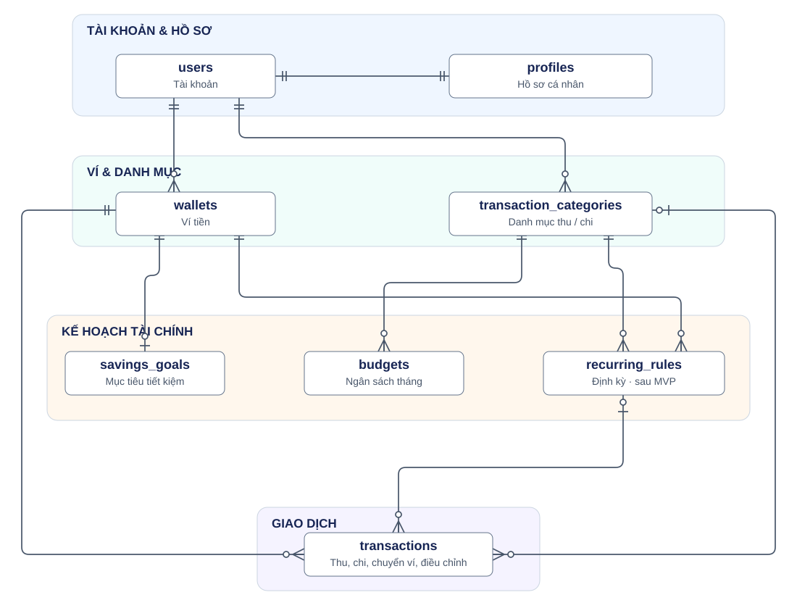

# Cơ sở dữ liệu DeSun

Schema đề xuất cho PostgreSQL, chưa có migration. MVP gồm 7 bảng nghiệp vụ; `recurring_rules` bổ sung sau.

## 1. Quan hệ giữa các bảng

[Mở sơ đồ để phóng to](database-diagram.svg)

Ký hiệu đầu đường nối: hai vạch = đúng một; vòng tròn + vạch = không hoặc một; vòng tròn + chân quạ = không hoặc nhiều.

Mọi bảng tài chính có `user_id → users.id`; sơ đồ lược bớt các đường sở hữu. Đường `wallets`–`transactions` thể hiện ví chính; giao dịch chuyển ví còn có ví đích tùy chọn (`to_wallet_id`).

## 2. Danh sách bảng

Quy ước: `PK` = khóa chính, `FK` = khóa ngoại, `?` = cho phép `NULL`; cột còn lại là `NOT NULL`. Mọi bảng có `created_at`, `updated_at` kiểu `timestamptz`, mặc định thời điểm tạo; `updated_at` cập nhật khi sửa. `id` là UUID tự sinh, riêng `profiles.id` dùng chung ID với `users`.

Tiền dùng `numeric(18,0)`, đơn vị VND. Tên phải trim và không rỗng. FK tài chính dùng `RESTRICT`/`NO ACTION` để bảo vệ lịch sử.

- **users** — Lưu tài khoản đăng nhập, mật khẩu đã hash và trạng thái tài khoản. Dùng custom User của Django với UUID.

  

  
Schema

  | Cột | Kiểu | Ràng buộc / ý nghĩa |
  |---|---|---|
  | `id` | `uuid` | PK |
  | `email` | `varchar(254)` | Duy nhất, không phân biệt hoa/thường |
  | `password` | `varchar(128)` | Hash theo định dạng Django |
  | `is_active` | `boolean` | Mặc định `true` |
  | `is_staff` | `boolean` | Mặc định `false` |
  | `is_superuser` | `boolean` | Mặc định `false` |
  | `last_login` | `timestamptz?` | Lần đăng nhập gần nhất |
  | `date_joined` | `timestamptz` | Mặc định thời điểm tạo |

  Unique index: `lower(trim(email))`. Các bảng quyền/nhóm và bảng trung gian do Django sinh không nằm trong 7 bảng nghiệp vụ này.

  

- **profiles** — Lưu tên hiển thị, ảnh đại diện và tùy chọn cá nhân. Mỗi tài khoản có đúng một hồ sơ.

  

  
Schema

  | Cột | Kiểu | Ràng buộc / ý nghĩa |
  |---|---|---|
  | `id` | `uuid` | PK, FK → `users.id` |
  | `display_name` | `varchar(100)` | Tên hiển thị |
  | `avatar_key` | `text?` | Khóa file ảnh trong object storage |
  | `currency_code` | `char(3)` | Mặc định và chỉ nhận `VND` trong MVP |
  | `timezone` | `text` | Mặc định và chỉ nhận `Asia/Ho_Chi_Minh` trong MVP |
  | `hide_balance` | `boolean` | Mặc định `false` |

  

- **wallets** — Lưu ví tiền mặt, ngân hàng, ví điện tử và ví tiết kiệm. Số dư được tính từ giao dịch.

  

  
Schema

  | Cột | Kiểu | Ràng buộc / ý nghĩa |
  |---|---|---|
  | `id` | `uuid` | PK |
  | `user_id` | `uuid` | FK → `users.id` |
  | `name` | `varchar(100)` | Tên ví |
  | `type` | `text` | `CASH`, `BANK`, `E_WALLET`, `SAVINGS` |
  | `account_hint` | `varchar(50)?` | Gợi nhớ tài khoản |
  | `icon` | `varchar(50)?` | Mã biểu tượng |
  | `color` | `varchar(20)?` | Mã màu |
  | `is_default` | `boolean` | Mặc định `false` |
  | `sort_order` | `integer` | Mặc định `0` |
  | `archived_at` | `timestamptz?` | Thời điểm ngừng sử dụng |

  Ràng buộc: `UNIQUE (user_id, id)`; unique index trên `user_id` khi `is_default = true AND archived_at IS NULL`. Ví đã lưu trữ không được là ví mặc định.

  Số dư = thu − chi + điều chỉnh có dấu − chuyển đi + chuyển đến, chỉ tính giao dịch chưa xóa. Số dư ban đầu là giao dịch `ADJUSTMENT`; không lưu cột số dư riêng.

  

- **transaction_categories** — Lưu danh mục thu/chi riêng của từng người dùng, dùng để phân loại giao dịch và đặt ngân sách.

  

  
Schema

  | Cột | Kiểu | Ràng buộc / ý nghĩa |
  |---|---|---|
  | `id` | `uuid` | PK |
  | `user_id` | `uuid` | FK → `users.id` |
  | `name` | `varchar(100)` | Tên danh mục |
  | `type` | `text` | `INCOME`, `EXPENSE` |
  | `icon` | `varchar(50)?` | Mã biểu tượng |
  | `color` | `varchar(20)?` | Mã màu |
  | `sort_order` | `integer` | Mặc định `0` |
  | `archived_at` | `timestamptz?` | Thời điểm ngừng sử dụng |

  Ràng buộc: `UNIQUE (user_id, id)`; unique index `(user_id, type, lower(trim(name)))` khi `archived_at IS NULL`. Không đổi loại danh mục đã được tham chiếu.

  

- **transactions** — Lưu thu, chi, chuyển ví và điều chỉnh số dư. Đây là dữ liệu gốc để tính số dư và báo cáo.

  

  
Schema

  | Cột | Kiểu | Ràng buộc / ý nghĩa |
  |---|---|---|
  | `id` | `uuid` | PK |
  | `user_id` | `uuid` | FK → `users.id` |
  | `type` | `text` | `INCOME`, `EXPENSE`, `TRANSFER`, `ADJUSTMENT` |
  | `wallet_id` | `uuid` | FK → `wallets.id`; ví chính / ví nguồn |
  | `to_wallet_id` | `uuid?` | FK → `wallets.id`; ví nhận chuyển |
  | `category_id` | `uuid?` | FK → `transaction_categories.id` |
  | `amount` | `numeric(18,0)` | Dương; riêng điều chỉnh có dấu, khác `0` |
  | `transaction_date` | `date` | Ngày nghiệp vụ |
  | `title` | `varchar(200)` | Nội dung ngắn |
  | `note` | `text?` | Ghi chú |
  | `idempotency_key` | `uuid` | Khóa chống tạo trùng |
  | `version` | `integer` | Mặc định `1`, lớn hơn `0` |
  | `deleted_at` | `timestamptz?` | Xóa mềm |
  | `recurring_rule_id` | `uuid?` | FK → `recurring_rules.id`; thêm sau MVP |
  | `scheduled_for` | `date?` | Kỳ định kỳ gốc; thêm sau MVP |

  Ràng buộc:

  - `UNIQUE (user_id, idempotency_key)`; `version` tăng sau mỗi lần sửa; không đổi `user_id`.
  - FK ghép `(user_id, wallet_id)`, `(user_id, to_wallet_id)` và `(user_id, category_id)` bảo đảm cùng chủ sở hữu.
  - `INCOME`/`EXPENSE`: số tiền dương, có danh mục khớp loại, không có ví đích.
  - `TRANSFER`: số tiền dương, có ví đích khác ví nguồn, không có danh mục; mỗi lần chuyển chỉ lưu một dòng.
  - `ADJUSTMENT`: số tiền khác `0`, không có danh mục/ví đích, có lý do trong `title` hoặc `note`.
  - Sau MVP: hai cột định kỳ cùng trống hoặc cùng có giá trị; FK ghép cùng chủ sở hữu và `UNIQUE (recurring_rule_id, scheduled_for)`, kể cả bản ghi đã xóa mềm.
  - Trigger kiểm tra loại danh mục khớp và không tạo/đổi tham chiếu sang ví hoặc danh mục đã lưu trữ.

  Chỉ mục khi `deleted_at IS NULL`: `(user_id, transaction_date DESC, id)`, `(user_id, wallet_id, transaction_date)`, `(user_id, to_wallet_id, transaction_date)`, `(user_id, category_id, transaction_date)`.

  Báo cáo thu/chi chỉ tính `INCOME` và `EXPENSE` chưa xóa, không tính chuyển ví hoặc điều chỉnh.

  

- **budgets** — Lưu hạn mức chi tiêu theo danh mục và tháng. Số đã chi được tính từ giao dịch trong tháng đó.

  

  
Schema

  | Cột | Kiểu | Ràng buộc / ý nghĩa |
  |---|---|---|
  | `id` | `uuid` | PK |
  | `user_id` | `uuid` | FK → `users.id` |
  | `category_id` | `uuid` | FK ghép cùng chủ sở hữu → `transaction_categories` |
  | `month_start` | `date` | Ngày đầu tháng |
  | `limit_amount` | `numeric(18,0)` | Lớn hơn `0` |
  | `alert_threshold` | `smallint` | Mặc định `80`, từ `1` đến `100` |

  Ràng buộc: `UNIQUE (user_id, category_id, month_start)`; kiểm tra ngày đầu tháng. Trigger chỉ chấp nhận danh mục `EXPENSE`, không tạo/đổi sang danh mục đã lưu trữ.

  

- **savings_goals** — Lưu mục tiêu tiết kiệm, mỗi mục tiêu gắn với một ví tiết kiệm riêng. Tiến độ bằng số dư ví đó so với số tiền mục tiêu.

  

  
Schema

  | Cột | Kiểu | Ràng buộc / ý nghĩa |
  |---|---|---|
  | `id` | `uuid` | PK |
  | `user_id` | `uuid` | FK → `users.id` |
  | `wallet_id` | `uuid` | FK ghép cùng chủ sở hữu → `wallets`, unique |
  | `name` | `varchar(150)` | Tên mục tiêu |
  | `target_amount` | `numeric(18,0)` | Lớn hơn `0` |
  | `deadline` | `date?` | Hạn hoàn thành |
  | `icon` | `varchar(50)?` | Mã biểu tượng |
  | `color` | `varchar(20)?` | Mã màu |
  | `status` | `text` | Mặc định `ACTIVE`; `ACTIVE`, `CANCELLED`, `ARCHIVED` |

  Trigger bảo đảm ví thuộc loại `SAVINGS` và không đổi loại ví đang gắn mục tiêu. Một ví chỉ gắn với một mục tiêu trong toàn bộ vòng đời.

  Không lưu `current_amount` hoặc trạng thái hoàn thành: tính từ số dư ví. Nạp/rút qua giao dịch chuyển ví; tiền mục tiêu đã nằm trong tổng tài sản, không cộng thêm lần nữa.

  

- **recurring_rules** — Lưu mẫu thu/chi định kỳ để sinh giao dịch theo lịch. Triển khai sau MVP.

  

  
Schema

  | Cột | Kiểu | Ràng buộc / ý nghĩa |
  |---|---|---|
  | `id` | `uuid` | PK |
  | `user_id` | `uuid` | FK → `users.id` |
  | `wallet_id` | `uuid` | FK ghép cùng chủ sở hữu → `wallets` |
  | `category_id` | `uuid` | FK ghép cùng chủ sở hữu → `transaction_categories` |
  | `type` | `text` | `INCOME`, `EXPENSE` |
  | `amount` | `numeric(18,0)` | Lớn hơn `0` |
  | `title` | `varchar(200)` | Nội dung giao dịch |
  | `frequency` | `text` | `DAILY`, `WEEKLY`, `MONTHLY`, `YEARLY` |
  | `anchor_date` | `date` | Ngày neo lịch gốc |
  | `next_run_date` | `date` | Kỳ tiếp theo chưa xử lý |
  | `ends_on` | `date?` | Không trước `anchor_date` |
  | `is_active` | `boolean` | Mặc định `true` |

  Ràng buộc: `UNIQUE (user_id, id)`; trigger kiểm tra loại danh mục khớp và trạng thái ví/danh mục khi tạo hoặc đổi tham chiếu. Chỉ mục `(next_run_date)` khi `is_active = true`.

  

